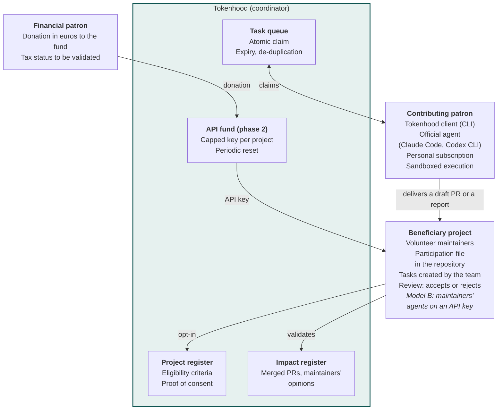
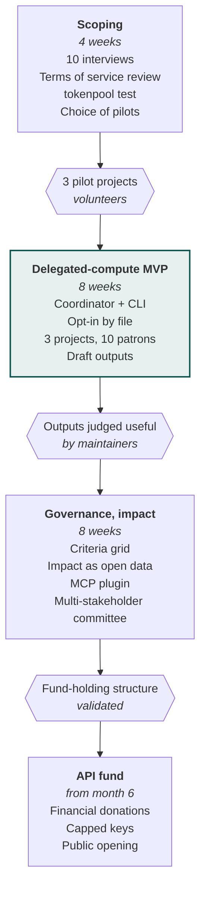

[V2.1 specifications](../README.md) › Related documents · [Version française](../etude-de-faisabilite.md)\
*Translation of the French source (translation status: `machine`, pending review).*

# Tokenhood: technical feasibility study

17 October 2026 · Mathieu

## Summary

Tokenhood is technically feasible, provided that the object of the donation is shifted: what is given is **computing time run by the patron themselves**, or **money converted into API credits**. The direct transfer of subscription tokens to a third party is blocked by the providers' terms of service and does not technically exist in the form of a monthly balance.

Two models hold up and can coexist:

- **Model A, delegated compute**: the patron runs their own official agent (Claude Code, Codex CLI) on tasks published by volunteer projects. Tokenhood orchestrates the task queue, the claims and the traceability, without ever touching credentials.
- **Model B, API fund**: financial donations feed an API account; Tokenhood distributes capped and measurable keys to maintainers.

Tokenhood's added value lies less in the technology, which is fairly simple, than in **governance**: maintainers' consent, project eligibility criteria, quality of contributions and transparency of impact.

| Building block | Feasibility | Difficulty | Sticking point |
| --- | --- | --- | --- |
| Donation of the subscription's "monthly remainder" | No | Blocking | Terms of service + quotas in rolling windows that cannot be carried over |
| Credential sharing or subscription proxy | No | Blocking | Explicitly forbidden since February 2026 on Anthropic's side |
| Task coordinator (model A) | Yes | Low | Already prototyped by others (tokenpool) |
| Local patron client (CLI, agent plugin) | Yes | Medium | Sandbox, prompt injection via issues |
| API fund with capped keys (model B) | Yes | Low | Legal status of the fund, tax treatment of patronage |
| Verifiable measurement of impact | Partial | High | Subscription consumption not measurable from the outside |
| Acceptability to maintainers | Uncertain | High | Saturation with AI-generated PRs |

The local folder and the GitHub repository `mathieu-kosmio/tokenhood` could not be read (empty folder, private or non-existent repository for this session): the study is based on the Notion note and on desk research.

## The concept

Tokenhood is a token patronage service, a "gift of intelligence for the commons". The scoping note ([Notion](https://app.notion.com/p/3fbd2a1120b6805ea0ffc55e7092726f)) provides for two donation gestures and a selection logic:

- giving the remaining tokens of one's subscription at the end of the month;
- using the tokens of one's subscription, on an ongoing basis, to contribute to open source projects;
- directing these contributions according to more or less demanding criteria.

Three actors structure the system: the **patron** (developer or organisation subscribed to an AI service), the **beneficiary project** (open source or digital commons, represented by its maintainers) and **Tokenhood**, a trusted third party that sets the rules, connects the parties and makes the impact visible.

The idea is part of a recent movement: the [Tokenware](https://elixirforum.com/t/tokenware-is-the-new-form-of-donation/75360) thread (May 2026) proposes pricing each feature in tokens, [tokenpool](https://github.com/rickheere/tokenpool) prototypes an open source coordinator, [OpenToken](https://open-token.org/) displays a vision of pooled credits without a published mechanism. Vendors also have their direct programmes: [Claude for Open Source](https://claude.com/open-source-max) (6 months of Max 20x) and [Codex for Open Source](https://developers.openai.com/codex/community/codex-for-oss) (6 months of ChatGPT Pro and API credits), reserved for maintainers of widely used projects. Tokenhood can cover the long tail that these programmes leave aside: sector-specific digital commons, small projects, non-code projects.

## Possible transfer mechanisms

Of five conceivable mechanisms, two are viable (local execution and API fund), one serves as a referral (vendor programmes) and two are to be excluded.

| Mechanism | Principle | Notion gesture covered | Terms of service compliance | Usage measurement | Verdict |
| --- | --- | --- | --- | --- | --- |
| 1. Local execution by the patron | The patron runs their official agent on a task claimed via Tokenhood | "Using the tokens of one's subscription" | Compatible: official tool, personal account, patron's machine | Declarative (budget on the client side) | Retained, core of the MVP |
| 2. API fund and capped keys | Financial donations converted into credits, dedicated keys per project with a cap and periodic reset | Funded variant of the "donation of the remainder" | Compatible: standard API use | Exact, per key | Retained, phase 2 |
| 3. Referral to vendor programmes | Tokenhood helps eligible projects apply (Claude for OSS, Codex for OSS) | None | Compatible | Not applicable | Retained as an ancillary service |
| 4. Proxy pooling patrons' API keys | Patrons deposit their API key, Tokenhood routes the projects' requests | "Donation of the remainder" | Risky: third party using another account's key, to be checked contract by contract | Exact | Rejected: custody of secrets, liability |
| 5. Sharing of credentials or subscription OAuth token | The patron hands over access to their subscription | "Donation of the remainder" | Forbidden (Anthropic, February 2026) | Impossible | Rejected |

The "give your monthly remainder" gesture must therefore be reformulated. Two honest translations: a **compute slot** (the patron lets their agent work through the Tokenhood queue when their quota is unused, for example at the end of a window or at night) or an equivalent **financial donation** to the API fund.

## Provider constraints

Consumer subscriptions are designed for individual use within the vendor's tools; only the API is designed for third-party and measurable use.

**Anthropic (Claude Pro, Max)**

- Section 3.7 of the Consumer Terms has forbidden unauthorised third-party harnesses since February 2024; the February 2026 clarification specifies that Free, Pro or Max OAuth tokens can only be used in Claude Code and claude.ai, Agent SDK included ([The Register](https://www.theregister.com/software/2026/02/20/anthropic-clarifies-ban-on-third-party-tool-access-to-claude/5014546)).
- The same terms forbid helping another person access the service in an unauthorised way: a service that would have a patron's subscription consumed by a third-party project would fall under this clause.
- Scripted use of Claude Code on one's own machine (`claude -p`, `setup-token` token for personal scripts) remains within the framework, with the recommendation to use the API for permanent or professional use ([Autonomee](https://autonomee.ai/blog/claude-code-terms-of-service-explained/)). This is what makes model A possible.
- Subscription quotas work in rolling windows shared with claude.ai, with no monthly balance that can be carried over: an end-of-month "remainder" does not exist as a transferable quantity.

**OpenAI (ChatGPT, Codex)**: the same principle of individual use needs to be checked in the current terms before opening Codex CLI as a supported client.

**API (all providers)**: per-token billing, revocable keys, measurable usage. [OpenRouter](https://openrouter.ai/docs/features/provisioning-api-keys) provisioning keys make it possible to programmatically create one key per project, with a credit cap, daily, weekly or monthly reset, and usage tracking, which covers model B without developing billing.

Consequence for the design: Tokenhood must never store, relay or derive a subscription credential, and cannot certify the quantity of tokens given in model A; it measures results (tasks delivered, PRs accepted).

## Target architecture

Tokenhood is a lightweight coordinator: it keeps the project register, the task queue and the impact register; all AI execution takes place at the patron's (model A) or at the maintainer's with a funded key (model B).

**Tokenhood coordinates, the patron executes, the maintainer decides**\
*Target architecture: model A (delegated compute) and model B (API fund)*

*Tokenhood never stores, relays or derives any subscription credential.*

The maintainer stays in control at each end of the chain: they open participation, create the tasks and validate what counts as impact.

Technical choices proposed for the MVP:

- **Consent**: a `.tokenhood.json` file in the repository, pointing to instructions in Markdown (scope, expected output format, task sizes), rechecked before each claim.
- **Coordinator**: REST API described in OpenAPI, SQL database, deployable on lean European infrastructure; authentication by GitHub identity, Tokenhood-specific token, revocable.
- **Patron client**: open source CLI that claims a task, prepares the context and launches the patron's official agent in a container; can be offered as a plugin or MCP server for Claude Code.
- **Two execution phases**: reading and proposal first, execution afterwards, the content of issues being treated as untrusted.
- **Outputs**: report, issue analysis, draft PR; never a direct PR without the project's explicit agreement.
- **Impact register**: open data, fed by public GitHub events and maintainers' opinions, exportable for lessons-learned reports (RETEX) and patrons' communication.
- **API fund**: keys created programmatically via OpenRouter provisioning keys, one per project, capped and tracked.

## Risks

The main risk is human: unsolicited AI contributions already overwhelm maintainers, and GitHub is considering allowing PRs to be disabled ([OpenSourceForU](https://www.opensourceforu.com/2026/02/github-weighs-pull-request-kill-switch-as-ai-slop-floods-open-source/), February 2026, about 1 AI PR in 10 judged up to standard according to a quoted maintainer). Tokenhood must be designed as a tool at the service of maintainers.

| Risk | Nature | Severity | Mitigation |
| --- | --- | --- | --- |
| Influx of low-quality PRs | Acceptability | High | Mandatory opt-in by the project, tasks created by maintainers, outputs as drafts or reports rather than direct PRs |
| Non-compliance with providers' terms of service | Legal | High | No credential handled, client limited to official tools, watch on the terms of service |
| Prompt injection via issues or project code | Security | High | Execution in a container, without secrets or unnecessary network, reading phase separate from the execution phase |
| Impersonation of a patron or project | Security | Medium | GitHub authentication, participation file in the repository as proof of consent |
| Unverifiable declared impact | Trust | Medium | Measure public results (merged PRs, closed issues, maintainer opinion) rather than tokens |
| Misguided gamification (race for volume) | Governance | Medium | Rankings based on acceptance by maintainers, not on the number of sessions |
| Status of the fund and tax treatment of patronage | Legal | Medium | Fund held by a structure eligible for patronage; subscription capacity is hard to value as an in-kind donation (to be validated with a lawyer) |
| Dependence on a provider | Strategic | Medium | Multi-agent client, support for open and local models |
| Infrastructure cost | Economic | Low | No agent run on the server side in model A; lightweight coordinator |

I am not a lawyer: the terms of service and tax points deserve formal validation before public launch.

## MVP and roadmap

The MVP aims to prove one thing only: volunteer maintainers find the outputs produced by patrons useful, without additional review burden. The API fund comes afterwards, once governance is in place.

**The delegated-compute MVP comes before any financial fund**\
*Four phases, three decision gates; indicative durations*

Durations are estimates for a small team; each gate conditions the next phase.

MVP scope:

- Coordinator: project register, task queue with claim and expiry, GitHub authentication.
- CLI client: claim, context preparation, launch of Claude Code in a container, filing of a draft PR or a report.
- Minimal public dashboard: registered projects, tasks handled, outputs accepted.
- Outside the MVP: API fund, rankings, multiple providers beyond Claude Code and Codex CLI.

## Open questions and next steps

Four structuring choices remain to be made before coding.

- Positioning with respect to tokenpool: contribute to this commons (MIT, very early), fork it, or build a governance and digital commons layer on top of it?
- Scope of beneficiaries: only open source repositories on GitHub, or also non-code commons (open data, documentation, reference datasets)?
- "More or less demanding" criteria grid: who defines it (Tokenhood, the patrons, a multi-stakeholder committee) and on what signals (licence, open governance, OpenSSF criticality, environmental impact)?
- Holder of the API fund: Kosmio, a dedicated association, or an existing partner funding the commons?

Next steps:

- [ ] Give access to the `mathieu-kosmio/tokenhood` repository for this session (or create it) and publish this study there
- [ ] Conduct 5 maintainer interviews and 5 patron interviews on acceptability and useful output formats
- [ ] Have the compliance with the Anthropic and OpenAI terms of service reviewed for model A
- [ ] Test tokenpool locally to decide whether to contribute or build
- [ ] Identify 3 pilot projects among the digital commons of the Kosmio ecosystem

## Sources

- [Tokenhood note, Notion](https://app.notion.com/p/3fbd2a1120b6805ea0ffc55e7092726f)
- [Anthropic clarifies ban on third-party tool access to Claude, The Register](https://www.theregister.com/software/2026/02/20/anthropic-clarifies-ban-on-third-party-tool-access-to-claude/5014546)
- [Claude Code Terms of Service Explained, Autonomee](https://autonomee.ai/blog/claude-code-terms-of-service-explained/)
- [Claude for Open Source](https://claude.com/open-source-max)
- [Codex for Open Source](https://developers.openai.com/codex/community/codex-for-oss)
- [OpenRouter, Provisioning API Keys](https://openrouter.ai/docs/features/provisioning-api-keys)
- [tokenpool, GitHub](https://github.com/rickheere/tokenpool)
- [Tokenware is the new form of donation, Elixir Forum](https://elixirforum.com/t/tokenware-is-the-new-form-of-donation/75360)
- [OpenToken](https://open-token.org/)
- [GitHub weighs pull request kill switch as AI slop floods open source, OpenSourceForU](https://www.opensourceforu.com/2026/02/github-weighs-pull-request-kill-switch-as-ai-slop-floods-open-source/)
