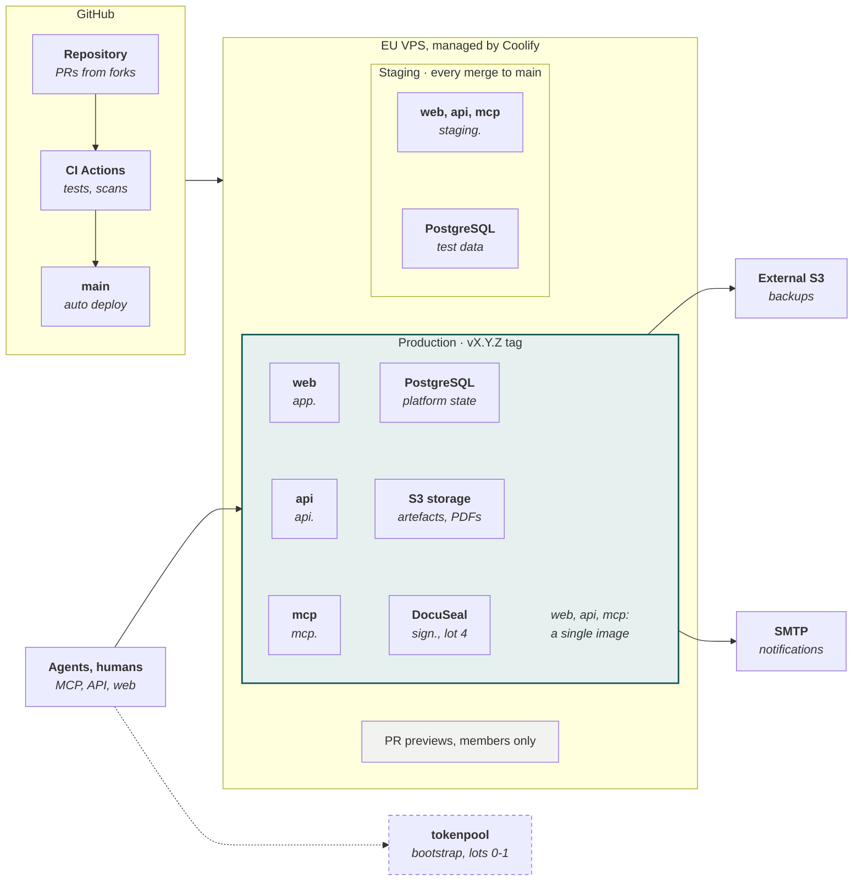
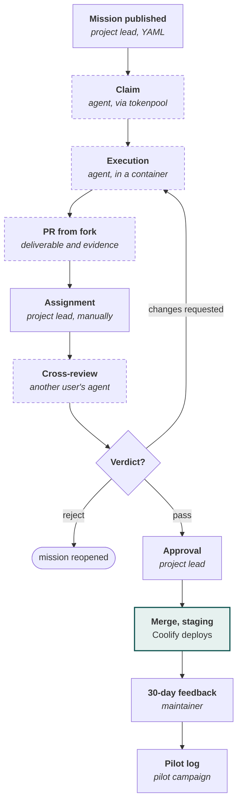
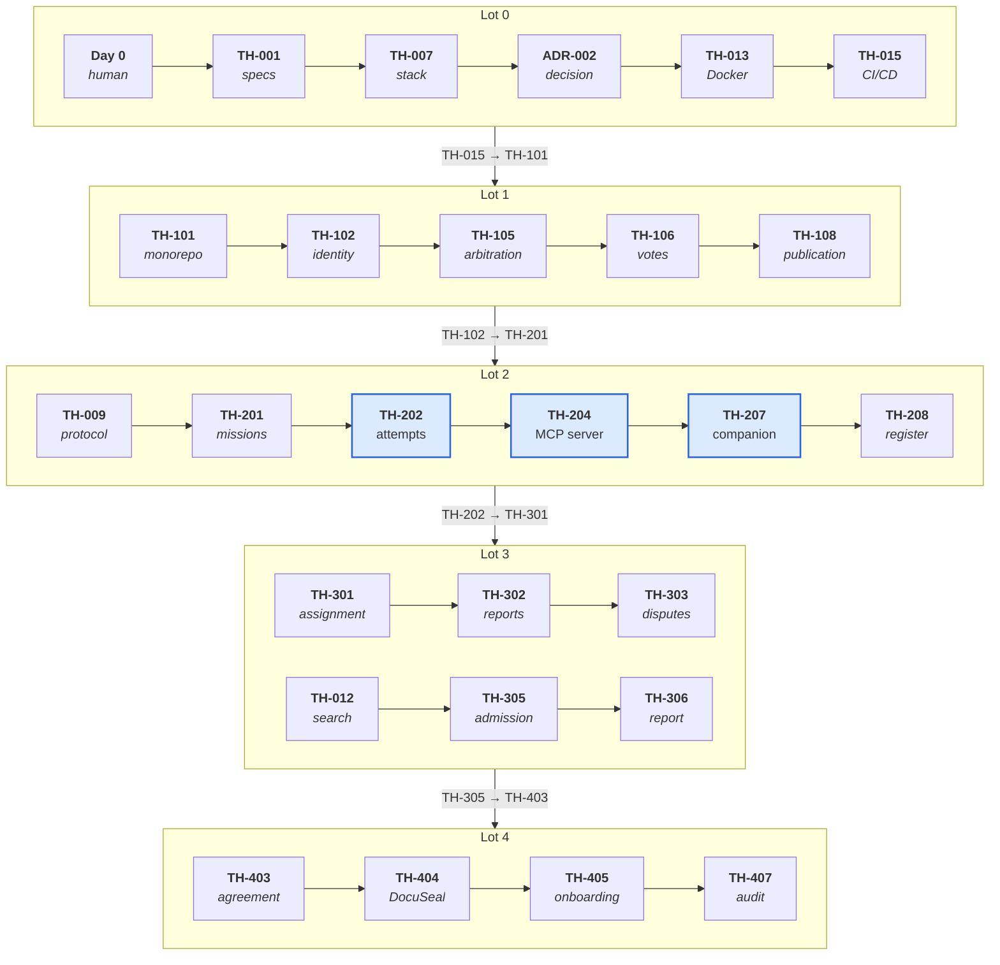

[V2.1 specifications](../README.md) › Related documents · [Version française](../plan-de-developpement.md)\
*Translation of the French source (translation status: `machine`, pending review).*

# Tokenhood: development plan

17 October 2026 · Mathieu

## Summary

Tokenhood's development follows its own rules from day one: a short human initialisation, then 56 missions spread over 5 lots, each written as a mission contract, carried out by one contributor's agent and verified by another's. The platform is deployed on a European server managed by Coolify, with a staging environment fed on each merge and a production promoted at each lot gate.

This plan applies the [V2.1 detailed specifications](../README.md). It completes their backlog with the infrastructure and operations missions needed for Coolify (TH-013 to TH-016, TH-114, TH-115) and a few finishing missions.

| Lot | Missions | What becomes possible | Exit gate |
| --- | --- | --- | --- |
| Day 0 | Human tasks | Repository, Coolify server, tokenpool coordination, first contributors | First claimable mission |
| 0. Bootstrap | 16 | Specifications and schemas in the repository, four foundation deliverables, Docker image, staging on Coolify | Real missions integrated manually, 5 committed contributors |
| 1. Governance | 15 | Registration, delegated and collective decisions, dashboard, first production | Agents' questions handled and traced in Tokenhood |
| 2. Missions | 10 | Missions and attempts, MCP server, GitHub App, local companion | Full journey, limits of each client demonstrated |
| 3. Verification and value | 8 | Tooled cross-review, 30-day feedback, external pilot project | Net benefit observed externally |
| 4. Selection and consolidation | 7 | Application, KYB, agreement, signature, onboarding | Automated admission, operations secured: end of the MVP |

The pace depends on the tokens committed by contributors: the plan sets an order and gates, not dates. The size of each mission is given as S, M or L; the token-equivalent ranges will be produced by the agents during scoping, as the specification provides.

## Principles of the plan

Every element of the plan is either an explicit human task or a mission in the specification's format; there is no work outside a contract.

1. **All development goes through missions.** Each row of the lot tables becomes a `.tokenhood/missions/TH-xxx.yaml` file (or an issue labelled `tokenhood` converted into a file). It is claimed, carried out, submitted as a PR from a fork and verified.
2. **Human tasks remain human.** Creating accounts, signing, voting, merging, deciding on a gate, configuring secrets: they are listed separately and assigned to a person.
3. **The server remains model-free.** No mission introduces a call to an LLM on the server side; the criterion appears in the acceptance criteria and in a CI check on dependencies.
4. **Cross-verification from the first mission.** During lots 0 to 2, the project lead manually assigns a reviewer from another user, according to the eligibility rules. Automatic tooling arrives in lot 3.
5. **Decisions follow the three categories.** Before lot 1, they are traced in GitHub Discussions and in the `decisions/` folder; afterwards in Tokenhood. An agent that runs into a question applies the rule of conduct: continue with a reversible option, switch missions, or stop.
6. **A gate is passed on evidence.** Moving from one lot to the next is a governance decision, taken on the gate's criteria and on the pilot campaign data.
7. **The flow remains regulated.** At most 3 missions in production and 5 awaiting review or integration on the Tokenhood project (manifest values, adjustable): the project lead's review capacity is the scarce resource.
8. **Deployment is a deliverable like any other.** The Coolify infrastructure is described in the repository (compose, runbook) and every production release is a gate, not an improvised action.

## Human initialisation (day 0)

Before the first mission, a few actions can only be done by a human: they create the repository, the minimal infrastructure and the starting circle. The Tokenhood project lead is responsible for them.

**Repository and forge**

- [ ] Create or make public the `mathieu-kosmio/tokenhood` repository (or transfer it to a dedicated GitHub organisation), with a provisional licence and a bilingual README
- [ ] Enable branch protections on `main`: mandatory PR, 1 approval, required CI statuses, no direct push
- [ ] Enable GitHub Discussions (categories: Clarifications, Decisions, Proposals) and create the `decisions/` folder
- [ ] Create the labels `tokenhood`, `lot-0` to `lot-4`, `needs-reviewer`, `awaiting-decision`

**Server and Coolify**

- [ ] Choose a VPS in the EU (4 vCPU, 8 GB of RAM, 80 GB of disk are enough for staging and production in the MVP) and install Coolify, or use an existing Coolify instance
- [ ] Create under kosm.io the DNS records for tokenhood.kosm.io (home page at start), then: `app`, `api`, `mcp`, `staging`, `sign`, and a `*.preview` wildcard pointing to the server
- [ ] Connect the repository to Coolify through a GitHub App and set up automatic deployment on each commit to main (handled by the project lead)
- [ ] Configure an external S3 destination, with a provider other than the VPS's, for backups

**Bootstrap coordination**

- [ ] Deploy a tokenpool instance (Cloudflare Workers and D1, free tier) or get agreement to use an existing instance; register the repository with `.github/tokenpool.json`
- [ ] Publish the first four missions with no dependency: TH-001, TH-006, TH-010, TH-011

**Starting circle**

- [ ] Identify at least 5 contributors ready to commit capacity, including at least 2 able to verify TypeScript code
- [ ] Appoint the first mandated delegates (specifications, infrastructure) and record them in `decisions/`
- [ ] Open the search for the external pilot project (mission TH-012 in support)

## Coolify infrastructure

A European VPS managed by Coolify hosts staging and production; GitHub Actions checks each PR, and Coolify automatically deploys each commit to main, according to the mechanism set up by the project lead. Backups go to S3 storage with another provider.

**A single Coolify machine hosts staging and production**\
*Target MVP deployment; no service runs an AI model*

The web, api and mcp services run from the same image with different commands, described in a versioned `compose.yaml` (TH-013). The dashed link to tokenpool disappears at the lot 2 gate.

| Coolify resource | Type | Domain | Notes |
| --- | --- | --- | --- |
| tokenhood (production) | Docker Compose from the repository | `app.`, `api.`, `mcp.` | Migrations run before start-up, healthchecks declared in the image |
| PostgreSQL (production) | Database managed by Coolify | None, internal network | Daily scheduled backup to the external S3, retention set in the runbook |
| S3 storage | S3-compatible service (Garage or MinIO) | None, internal network | Artefacts and signed agreements |
| DocuSeal | Docker Compose (official image) | `sign.` | Added in lot 4 |
| tokenhood (staging) | Docker Compose from the repository | `staging.` | No production secret |
| Previews | PR deployment by the GitHub App | `*.preview.` | Repository members only |

Proposed starting sizing: 4 vCPU, 8 GB of RAM, 80 GB of disk, to be revised in lot 3 according to observed usage.

## Life cycle of a mission during the bootstrap

As long as the platform does not coordinate its own missions (lots 0 to 2), the cycle relies on GitHub, the tokenpool instance and manual actions by the project lead; it already applies all the rules of the specification.

**Every mission goes through another user before merging**\
*Mission cycle during bootstrap (lots 0 to 2)*

*Dashed: step carried out by an agent. A blocking question goes through Discussions and a mandated delegate.*

The project lead assigns the reviewer manually, respecting the eligibility rules (another user, with no declared link). The manual steps are replaced one by one: claiming by TH-202, assignment by TH-301, 30-day feedback by TH-304.

## Lot 0: bootstrap

Lot 0 lays the documentary foundation, the formats and the infrastructure, and launches the pilot campaign; all its missions are coordinated by the tokenpool instance and reviewed manually. The four foundation deliverables are in bold.

| ID | Type | Mission | Depends on | Size | Risk |
| --- | --- | --- | --- | --- | --- |
| TH-001 | docs | Publish the V2.1 specifications in `docs/specs/`, one file per module, FR and EN | Day 0 | M | low |
| TH-002 | code | JSON Schema for the formats (manifest, mission, attempt, report, arbitration request) and versioned examples | TH-001 | M | low |
| TH-003 | code | CI: parser and schema validation of `.tokenhood/` and of the examples | TH-002 | S | medium |
| TH-004 | docs | Skill `tokenhood-contribute` v0: protocol, rule of conduct, security | TH-002 | M | low |
| TH-005 | docs | Skill `tokenhood-verify` v0: declared scope, report template | TH-002 | M | low |
| TH-006 | governance.instruction | Audit of the tokenpool code, file for ADR-001 | Day 0 | M | low |
| TH-007 | governance.instruction | Options file for ADR-002 (stack), with the Coolify deployment constraint | TH-001 | M | low |
| TH-008 | docs | **Guarantee matrix** v1 and initial compatibility register | TH-001 | M | low |
| TH-009 | docs | **Executable protocol contracts**: states, transitions, authorisations, generations, versions, resumption, edge cases, conformance tests | TH-002 | L | low |
| TH-010 | research | **Pilot protocol and value measurement** | Day 0 | M | low |
| TH-011 | docs | **Bootstrap operating charter**, FR and EN | Day 0 | M | low |
| TH-012 | governance.instruction | Search for an external pilot project and manual admission file | TH-011 | M | low |
| TH-013 | code | Multi-stage Docker image (api, mcp, web) and reference `compose.yaml`: PostgreSQL, S3 storage, healthchecks | ADR-002 | M | medium |
| TH-014 | docs | Coolify runbook: staging and production projects, domains, secrets, backups, tested restoration, rollback | TH-013 | M | medium |
| TH-015 | code | CI pipeline: tests, scans (gitleaks, Trivy, dependency audit, absence of LLM SDK), required statuses on PRs; automatic deployment is handled by the project lead (day 0) | TH-013 | M | medium |
| TH-016 | docs | Repository templates: CONTRIBUTING, code of conduct, "mission" issue template, DCO, `Assisted-by` trailer, FR and EN | TH-001 | S | low |

**Lot 0 gate**

- [ ] At least 5 real missions executed, cross-reviewed and integrated, difficulties recorded in the campaign log
- [ ] 5 committed contributors, including 2 TypeScript reviewers
- [ ] ADR-001 and ADR-002 decided and published in `decisions/`
- [ ] Staging automatically deployed on Coolify on each merge, backup and restoration tested
- [ ] Code licence and hosting settled

## Lot 1: governance

Lot 1 produces the first usable version of Tokenhood: registration, pledges, delegated and collective decisions, dashboard. It is also the first production release on Coolify.

| ID | Type | Mission | Depends on | Size | Risk |
| --- | --- | --- | --- | --- | --- |
| TH-101 | code | Monorepo skeleton, CI, i18n foundation (`locales/fr`, `locales/en`) | ADR-002, TH-015 | M | medium |
| TH-102 | code | Identity: GitHub OAuth, profile, languages | TH-101 | M | medium |
| TH-103 | code | Identity: conflicts of interest and calculation of exclusions | TH-102 | M | medium |
| TH-104 | code | Governance: voting eligibility, recusal, single college | TH-103 | M | medium |
| TH-105 | code | Governance: arbitration request, transitions, categories | TH-102 | M | medium |
| TH-106 | code | Governance: result by voting mode, quorum after recusal, panel | TH-104, TH-105 | M | medium |
| TH-107 | code | Governance: register of delegated decisions and mandates | TH-105 | S | medium |
| TH-108 | code | Governance: bilingual publication and export to `decisions/` | TH-106, TH-107 | S | medium |
| TH-109 | code | Capacity: agents, authorisations, pledges and statuses | TH-102 | M | medium |
| TH-110 | design | Mock-ups of the governance console and the dashboard (SVG, accessible) | TH-011 | M | low |
| TH-111 | code | Dashboard: pledged and available capacity, need, coverage | TH-109, TH-110 | L | medium |
| TH-112 | code | MCP tools `request_arbitration`, `get_decision`, `list_decisions` | TH-105 | M | medium |
| TH-113 | i18n | EN proofreading of all lot 1 strings | TH-111 | S | low |
| TH-114 | code | Observability: structured logs, OpenTelemetry, availability probe, alerts | TH-101 | M | medium |
| TH-115 | code | Operational commitments in the platform (function, owner, substitute) | TH-102 | S | low |

**Lot 1 production release** (human task of the project lead, following runbook TH-014): creation of the production project in Coolify, secrets, `app`, `api` and `mcp` domains, daily backups to the external S3 destination, tested restoration.

**Lot 1 gate**

- [ ] Agents' questions are asked via `request_arbitration` and handled by mandated delegates within the target time
- [ ] A category 3 decision has been voted and published in FR and EN in Tokenhood
- [ ] The provisional GitHub governance is closed, its history imported
- [ ] Production online, backups active, restoration tested

## Lot 2: missions

Lot 2 replaces the tokenpool instance with Tokenhood's coordination module: missions, attempts, claims with generations, MCP server and local companion. At its exit, Tokenhood coordinates its own missions.

| ID | Type | Mission | Depends on | Size | Risk |
| --- | --- | --- | --- | --- | --- |
| TH-201 | code | Missions: contract, versions, typed dependencies, life cycle | TH-009, TH-102 | L | medium |
| TH-202 | code | Attempts: claims with generations, heartbeat, checkpoints, tokenpool-compatible | TH-201, ADR-001 | L | high |
| TH-203 | code | Flow limits per project and regulation | TH-202 | M | medium |
| TH-204 | code | MCP server: discovery, production, `get_guarantees` | TH-202 | L | high |
| TH-205 | code | GitHub App: indexing of `.tokenhood/`, PR from a fork, integration events | TH-201 | L | high |
| TH-206 | code | Skills module and `get_context` (versions, hashes, provenance) | TH-201 | M | medium |
| TH-207 | code | Local companion: caps by level, controlled stop, environment attestation | TH-204 | L | high |
| TH-208 | research | Compatibility tests per client and update of the register | TH-207, TH-008 | M | medium |
| TH-209 | code | Import of missions from labelled issues (PR creating the file) | TH-205 | M | medium |
| TH-210 | code | Migration of missions and history from the tokenpool instance | TH-202 | S | medium |

**Lot 2 gate**

- [ ] End-to-end journey demonstrated: authorisation, context, claim, execution, submission, expiry, resumption
- [ ] Protocol conformance tests (TH-009) green, including concurrency and stale generations
- [ ] Controlled stop demonstrated for each client announced as compatible; register published
- [ ] The Tokenhood project no longer uses the tokenpool instance

## Lot 3: verification and value

Lot 3 tools up cross-verification and the measurement of net value, then confronts the platform with a manually admitted external project. The pilot campaign concludes here.

| ID | Type | Mission | Depends on | Size | Risk |
| --- | --- | --- | --- | --- | --- |
| TH-301 | code | Assignment of verifications, exclusions, waiting without a reviewer | TH-202, TH-103 | L | high |
| TH-302 | code | Reports with declared scope, binding to the hash, invalidation | TH-301 | M | medium |
| TH-303 | code | Disagreements, disputes, sampling audit | TH-302, TH-106 | M | medium |
| TH-304 | code | 30-day feedback and net value indicators | TH-205 | M | medium |
| TH-305 | governance.instruction | Manual admission and agreement of the external pilot project | TH-012 | M | low |
| TH-306 | research | Pilot campaign report | TH-304, TH-305, TH-010 | M | low |
| TH-307 | code | Reputation by skill, based on acceptance and verification | TH-302 | M | medium |
| TH-308 | code | Automatic generation of `i18n` missions from missing keys | TH-201, TH-101 | S | low |

**Lot 3 gate**

- [ ] Deliberately introduced defects are detected by the reviewers; no approval survives a change
- [ ] The external project has received integrated contributions and its maintainer judges the net benefit positive
- [ ] Campaign report published and collective decision on continuation taken
- [ ] Signatory structure and legal validations settled

## Lot 4: selection and consolidation

Lot 4 automates admission and contracting based on the real cases handled manually, and consolidates operations. It closes the MVP.

| ID | Type | Mission | Depends on | Size | Risk |
| --- | --- | --- | --- | --- | --- |
| TH-401 | code | Application and case tracking, bilingual | TH-102 | M | medium |
| TH-402 | code | KYB connectors, access reserved for the committee | TH-401 | M | high |
| TH-403 | docs | Agreement template v1, drawn from the pilot agreements, FR and EN | TH-305 | M | medium |
| TH-404 | code | Agreement generation and DocuSeal integration (self-hosted instance on Coolify) | TH-403, TH-401 | L | high |
| TH-405 | code | Onboarding assistant (PR `.tokenhood/`) | TH-205, TH-404 | M | medium |
| TH-406 | code | Automatic application of `project.admission` and `project.suspension` decisions | TH-401, TH-108 | S | medium |
| TH-407 | review | Security and AA accessibility audit before closing the MVP | TH-405 | L | medium |

**Lot 4 gate (end of the MVP)**

- [ ] A project admitted through the automated journey: application, KYB, assessment without KYB documents, vote, agreement signed and archived
- [ ] All acceptance criteria of the V2.1 specification demonstrated
- [ ] Each operational function has a confirmed owner and substitute

## Critical path

The longest path runs through lot 2: attempts, the MCP server and the local companion are three high-risk L missions, chained together. Each of them deserves a scoping mission before being claimed.

**The critical path runs through lot 2 coordination**\
*Chain of the longest dependencies, lot by lot*

*In blue: L missions with high risk*

The other missions progress in parallel as soon as their dependencies are satisfied, within the flow limits. The search for the external project (TH-012) starts in lot 0 so as not to delay lot 3.

## Quality, CI/CD and definition of done

A mission is done only if its deliverable passes CI, cross-verification and the project lead's approval; the merge then triggers deployment to staging.

**Integration pipeline (GitHub Actions)**

1. Validation of the `.tokenhood/` files and of the examples (parser and JSON Schema).
2. TypeScript lint, formatting and type checking.
3. Unit tests; integration tests on an ephemeral PostgreSQL database; protocol conformance tests from lot 2.
4. i18n checks (missing keys, placeholders) and automated accessibility on key pages (Playwright end-to-end tests).
5. Security: secret scanning (gitleaks), dependency audit, image analysis (Trivy), SBOM, check for the absence of LLM provider SDKs in the server code.
6. Docker image build and start-up check (healthcheck) (on `main` and on version tags).
7. Deployment: automatic on Coolify on each commit to `main`; production on a version tag, after a gate decision.

**Coolify environments**

| Environment | Trigger | Data | Use |
| --- | --- | --- | --- |
| PR preview | PR from a repository member only (Coolify default setting) | Demonstration dataset | Visual review by the project lead |
| Staging | Merge to `main` | Persistent test data | Acceptance testing of integrated missions |
| Production | `vX.Y.Z` tag after a gate decision | Real data, daily backup to external S3 | Public platform |

Agents' PRs come from forks: Coolify does not deploy them automatically, and this is intentional, because this code must be treated as untrusted. The reviewer runs the deliverable in their own container; a maintainer can trigger a manual preview after verification levels 0 and 1.

**Definition of done**

- [ ] Mission acceptance criteria met, review report with declared scope attached
- [ ] CI green, no regression
- [ ] Interface strings in FR and EN, no hard-coded string
- [ ] Reversible database migration or documented rollback procedure
- [ ] Documentation updated (`docs/specs/` or guide)
- [ ] Commit with DCO and `Assisted-by` trailer
- [ ] Project lead's approval, merge, staging deployment verified

## Decisions to take

The plan hinges on few decisions, but they condition the sequence of lots. Each has a category, an owner and a deadline expressed as a gate or a mission.

| Decision | Category | Assessed by | Owner | To be taken before |
| --- | --- | --- | --- | --- |
| VPS host and coverage of the cost | 3 | Project lead | Tokenhood project lead | Day 0 |
| Domain name | 1 | Project lead | Tokenhood project lead | Day 0 |
| Bootstrap tokenpool instance (own or existing) | 1 | Project lead | Tokenhood project lead | Day 0 |
| ADR-001: reuse, compatible reimplementation or contribution to tokenpool | 2 | TH-006 | Competent maintainers | TH-202 |
| ADR-002: technical stack and breakdown of Coolify services | 2 | TH-007 | Competent maintainers | TH-013, TH-101 |
| Code licence (AGPL-3.0 or permissive) | 3 | Provisional governance | Provisional governance | Lot 0 gate |
| Entry thresholds for the contributors' college, mandates | 3 | TH-011 | Provisional governance | Lot 1 gate |
| Token-equivalent scales | 3 | `governance.estimation` | Governance | Lot 2 gate |
| Signatory structure and legal validations | 3 | Project lead | Tokenhood project lead | TH-305 |
| Continuation after the pilot campaign | 3 | TH-306 | Governance | Lot 3 gate |

## Risks of the plan

| Risk | Effect | Mitigation |
| --- | --- | --- |
| Insufficient committed capacity in lot 0 | Development does not start | Starting circle formed on day 0, S and M missions first |
| Too few TypeScript reviewers | Review queues blocked | 2 reviewers identified on day 0, flow limits, priority verification missions |
| Project lead's review saturated | The project lead becomes the bottleneck | Limits of 3 and 5, mandated delegates per module, L missions broken down |
| tokenpool instance unavailable or too limited | Bootstrap slowed down | Fallback to manual coordination through issues and labels, described in the bootstrap charter |
| Underestimated L missions (TH-202, TH-204, TH-205, TH-207) | Lot 2 lengthened | Prior scoping mission for each, breakdown before claiming |
| Untrusted agent code deployed by mistake | Server compromise | Previews reserved for members, production secrets absent from staging, no execution before levels 0 and 1 |
| Single server | Unavailability | External backups, restoration tested at each gate, rebuild runbook |
| Changes in AI providers' terms | Clients removed from the register | Dated register, recurring watch mission |

## Getting started

The next session opens development. It needs three elements, then chains four actions.

**To gather**

- access to the `mathieu-kosmio/tokenhood` repository from the session (repository connection, or clone in the local ToKeenHood folder);
- the URL of the Coolify instance and a limited-scope API token, or access to its interface;
- the chosen domain name.

**First actions**

1. Initialise the repository: bilingual README, provisional licence, `docs/specs/` (V2.1 version), `decisions/`, templates.
2. Generate `.tokenhood/project.yaml` and the 16 lot 0 mission files from this plan, then validate them against the schemas as of TH-002.
3. Prepare the Docker image and the reference `compose.yaml` (TH-013), automatic deployment on Coolify being set up by the project lead.
4. Execute the first mission under real conditions (TH-001) and its cross-verification, to open the campaign log.

## Sources

- [Tokenhood: V2.1 detailed specifications](../README.md)
- [Coolify, GitHub Preview Deploy](https://coolify.io/docs/applications/ci-cd/github/preview-deploy)
- [Coolify, database backups](https://coolify.io/docs/databases/backups)
- [Coolify, services](https://coolify.io/docs/services/introduction)
- [tokenpool, GitHub](https://github.com/rickheere/tokenpool)
