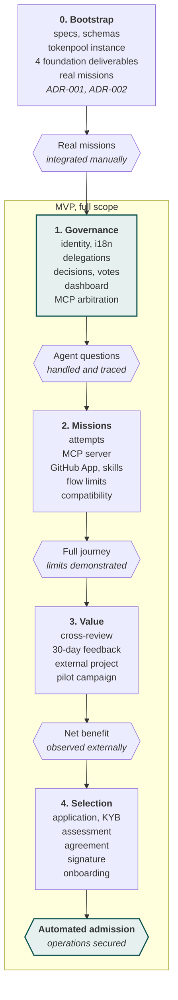

[V2.1 specifications](../README.md) › Module 22/28 · [Version française](../roadmap.md)\
*Translation of the French source (translation status: `machine`, pending review).*

# Roadmap and development order

Governance is the first lot produced, after a bootstrap. The agents building Tokenhood will ask questions from their very first missions: we need to know who answers them, within what time and with what trace. Lot 0 coordinates these first missions with a tokenpool instance and provisional governance in GitHub (Discussions and the `decisions/` folder). V2.1 confronts the system with an external project as early as lot 3: building Tokenhood with Tokenhood is not enough to prove that it suits another project.

**Governance is the first lot produced, after a bootstrap**\
*Development lots and gates; pace set by committed tokens, not by dates*

The MVP scope is kept in full, delivered in four lots ordered by dependency. The gates now check demonstrated value rather than internal use of the features.

| Lot | Content | Exit gate |
| --- | --- | --- |
| 0. Bootstrap | Repository, specifications, schemas, platform skills v0, tokenpool instance, provisional governance; four foundation deliverables carried out as missions (guarantee matrix, executable protocol contracts, pilot protocol and value measurement, bootstrap operating charter); ADR-001 and ADR-002; search for the external pilot project | A few real missions executed and integrated with manual coordination and review; difficulties recorded; 5 committed contributors |
| 1. Governance | Identity and registration, FR/EN i18n foundation, agents and pledges, register of delegated decisions and mandates, collective decisions, dashboard, MCP arbitration tools | Agents' questions are handled by the decision register and mandated delegates, without depending on a complete institutional system |
| 2. Missions | Missions and attempts, claims with generations, flow limits, MCP server, GitHub App, skills, local companion, compatibility register | End-to-end journey (authorisation, context, claim, execution, submission, resumption); limits of each client demonstrated |
| 3. Verification and value | Assignment, review with declared scope, invalidation, waiting without a reviewer, sampling audit, 30-day feedback; external project admitted manually; end of the pilot campaign | Reviews cover the right versions, test defects are detected, the external project observes a net benefit |
| 4. Selection and consolidation | Application, KYB, assessment, agreements, DocuSeal signature and onboarding, automated from the proven process | Admission and contracting automated on real cases; operational responsibilities confirmed: end of the MVP |

Tokenhood remains the first beneficiary, governance remains early, cross-review remains mandatory and selection remains real. During lots 0 to 2, cross-verification is applied manually: the Tokenhood project lead assigns a reviewer from another user, according to the eligibility rules.

**After the MVP**: GitLab then Forgejo, new languages, federation between coordinators, upstream contributions to tokenpool, advanced multimedia missions, verified execution environments.

---

← [Interfaces](interfaces.md) · [Contents](../README.md) · [Pilot campaign and continuation criteria](campagne-pilote.md) →
