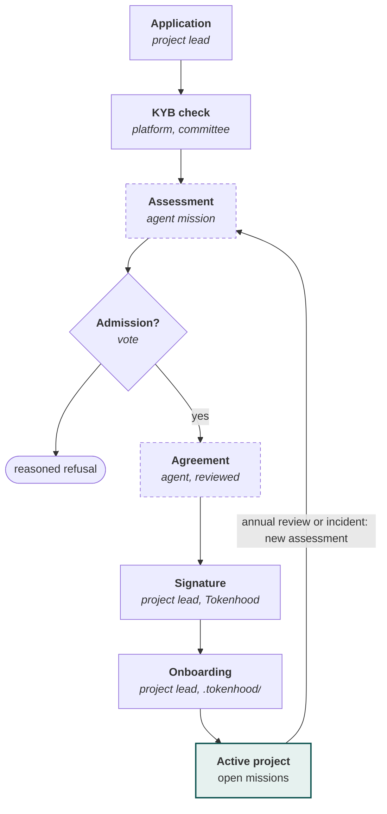

[V2.1 specifications](../README.md) › Module 8/28 · [Version française](../selection-et-contractualisation.md)\
*Translation of the French source (translation status: `machine`, pending review).*

# Project selection and contracting

Projects are carefully selected: a project opens missions only after a KYB check, a governance vote and the signature of an agreement in the platform. This process is an MVP feature.

**A project becomes active after KYB, vote and signature**\
*Selection and contracting process*

*Dashed: step carried out by an agent mission, then validated by a human*

The cognitive steps (assessment, drafting of the agreement) are missions entrusted to contributors' agents; decisions and signatures remain human.

**During the pilot** (lots 0 to 3), admission and the agreement are handled manually according to the same requirements, documented, then recorded in Tokenhood. The full automation of lot 4 takes over the process proven on these real cases. Admission checks verify a project lead, their control of the repository and their ability to commit; the technical safety of the repository's content remains covered by the execution protections, which apply in addition.

**Application.** Bilingual form: repository(ies), licence, description, project governance, host organisation, lead maintainer, expected needs (mission types, estimated volume), link with the digital commons or the transition.

**KYB check** (Know Your Business), depending on the form of the project lead:

| Project lead | Checks | Source |
| --- | --- | --- |
| French legal entity | Active SIREN, directors, consistency with the signatory | [API Recherche d'entreprises](https://github.com/annuaire-entreprises-data-gouv-fr/search-api) |
| Legal entity outside France | Registration, legal representative | National register or LEI, supporting documents |
| Foundation or fiscal host | Status, mandate for the project | Supporting documents, official page |
| Collective without a legal structure | Verified identity of at least 2 maintainers | Enhanced identity verification |
| All | Repository control (admin rights, proof file), OSI-approved licence, recent activity | Forge API |

**Assessment.** An assessment mission (type `governance.instruction`) produces a standardised file: summary, scored criteria grid, risks, recommendation. The assessing agent receives only the application and public data (repository, licence, activity, project website); KYB documents and results are never passed to an agent and remain reserved for the selection committee, which checks them itself. The assessing agent must have no declared link with the project. Grid criteria (weightings set by governance): licence and openness, project governance, maintainers' review capacity, usefulness for the commons, maturity of the breakdown into missions, readiness to receive contributions from agents, security, alignment with the charter.

**Decision.** An arbitration request of type `project.admission` is opened in the governance module. Vote by qualified majority, with recusal of linked members.

**Agreement.** Generated from a template versioned in the `tokenhood` repository (Markdown with variables), completed by an agent mission, reviewed by the committee. Minimum content:

- purpose, duration (12 months, renewable), project contact;
- project commitments: maximum review time, quality of missions, respect of cross-verification, licence, code of conduct, transparency of results;
- Tokenhood commitments: orchestration, security, neutrality of allocation, publication of impact;
- intellectual property: contributions under the project's licence, DCO;
- personal data, suspension, termination, disputes.

**Signature.** Electronic signature through a self-hosted instance of [DocuSeal](https://dev.co/devops/open-source/docuseal) (AGPL-3.0, API and webhooks), used without modification. The signed PDF and the audit trail are archived; the document hash is recorded in Tokenhood's audit log.

**Onboarding.** The project lead installs `.tokenhood/` in their repository (assistant generating a PR); the platform checks the manifest and activates the project.

**Project statuses**: `candidate` → `kyb_pending` → `under_review` → `approved` / `rejected` → `contract_pending` → `active` → `suspended` / `ended`.

---

← [Registration and identity](inscription-et-identite.md) · [Contents](../README.md) · [Missions](missions.md) →
