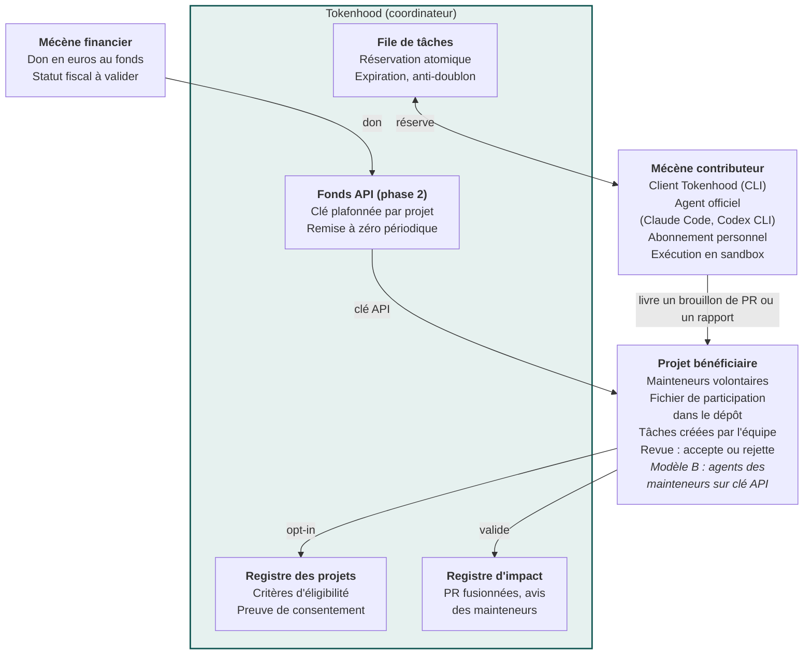
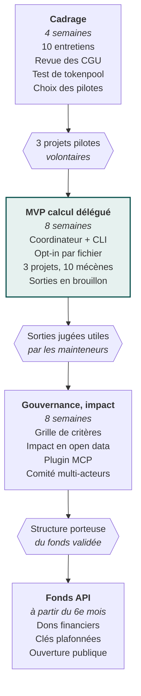

[Spécifications V2.1](README.md) › Documents associés · [English version](en/etude-de-faisabilite.md)

# Tokenhood : étude de faisabilité technique

17 octobre 2026 · Mathieu

## Synthèse

Tokenhood est faisable techniquement, à condition de déplacer l'objet du don : on donne du **temps de calcul exécuté par le mécène lui-même**, ou de **l'argent converti en crédits API**. Le transfert direct de tokens d'abonnement vers un tiers est bloqué par les CGU des fournisseurs et n'existe pas techniquement sous forme de solde mensuel.

Deux modèles tiennent la route et peuvent coexister :

- **Modèle A, calcul délégué** : le mécène fait tourner son propre agent officiel (Claude Code, Codex CLI) sur des tâches publiées par des projets volontaires. Tokenhood orchestre la file de tâches, les réservations et la traçabilité, sans jamais toucher aux identifiants.
- **Modèle B, fonds API** : des dons financiers alimentent un compte API ; Tokenhood distribue aux mainteneurs des clés plafonnées et mesurables.

La valeur ajoutée de Tokenhood se situe moins dans la technique, assez simple, que dans la **gouvernance** : consentement des mainteneurs, critères d'éligibilité des projets, qualité des contributions et transparence de l'impact.

| Brique | Faisabilité | Difficulté | Point dur |
| --- | --- | --- | --- |
| Don du « reste mensuel » d'abonnement | Non | Bloquant | CGU + quotas en fenêtres glissantes non reportables |
| Partage d'identifiants ou proxy d'abonnement | Non | Bloquant | Interdit explicitement depuis février 2026 côté Anthropic |
| Coordinateur de tâches (modèle A) | Oui | Faible | Déjà prototypé par d'autres (tokenpool) |
| Client mécène local (CLI, plugin d'agent) | Oui | Moyenne | Sandbox, injection de prompt via les issues |
| Fonds API avec clés plafonnées (modèle B) | Oui | Faible | Statut juridique du fonds, fiscalité du mécénat |
| Mesure vérifiable de l'impact | Partielle | Élevée | Consommation d'abonnement non mesurable de l'extérieur |
| Acceptabilité par les mainteneurs | Incertaine | Élevée | Saturation des PR générées par IA |

Le dossier local et le dépôt GitHub `mathieu-kosmio/tokenhood` n'ont pas pu être lus (dossier vide, dépôt privé ou inexistant pour cette session) : l'étude part de la note Notion et d'une recherche documentaire.

## Le concept

Tokenhood est un service de mécénat de tokens, un « don d'intelligence pour les communs ». La note de cadrage ([Notion](https://app.notion.com/p/3fbd2a1120b6805ea0ffc55e7092726f)) prévoit deux gestes de don et une logique de sélection :

- donner le reste de tokens de son abonnement en fin de mois ;
- utiliser les tokens de son abonnement, au fil de l'eau, pour contribuer à des projets open source ;
- orienter ces contributions selon des critères plus ou moins exigeants.

Trois acteurs structurent le système : le **mécène** (développeur ou organisation abonnée à un service d'IA), le **projet bénéficiaire** (open source ou commun numérique, représenté par ses mainteneurs) et **Tokenhood**, tiers de confiance qui fixe les règles, met en relation et rend l'impact visible.

L'idée s'inscrit dans un mouvement récent : le fil [Tokenware](https://elixirforum.com/t/tokenware-is-the-new-form-of-donation/75360) (mai 2026) propose de chiffrer chaque fonctionnalité en tokens, [tokenpool](https://github.com/rickheere/tokenpool) prototype un coordinateur open source, [OpenToken](https://open-token.org/) affiche une vision de crédits mutualisés sans mécanisme publié. Les éditeurs ont aussi leurs programmes directs : [Claude for Open Source](https://claude.com/open-source-max) (6 mois de Max 20x) et [Codex for Open Source](https://developers.openai.com/codex/community/codex-for-oss) (6 mois de ChatGPT Pro et crédits API), réservés aux mainteneurs de projets très utilisés. Tokenhood peut couvrir la longue traîne que ces programmes laissent de côté : communs numériques sectoriels, petits projets, projets non-code.

## Mécanismes de transfert possibles

Sur cinq mécanismes envisageables, deux sont viables (exécution locale et fonds API), un sert d'aiguillage (programmes éditeurs) et deux sont à exclure.

| Mécanisme | Principe | Geste Notion couvert | Conformité CGU | Mesure de l'usage | Verdict |
| --- | --- | --- | --- | --- | --- |
| 1. Exécution locale par le mécène | Le mécène lance son agent officiel sur une tâche réservée via Tokenhood | « Utiliser les tokens de son abonnement » | Compatible : outil officiel, compte personnel, machine du mécène | Déclarative (budget côté client) | Retenu, cœur du MVP |
| 2. Fonds API et clés plafonnées | Dons financiers convertis en crédits, clés dédiées par projet avec plafond et remise à zéro périodique | Variante financée du « don du reste » | Compatible : usage API standard | Exacte, par clé | Retenu, phase 2 |
| 3. Orientation vers les programmes éditeurs | Tokenhood aide les projets éligibles à candidater (Claude for OSS, Codex for OSS) | Aucun | Compatible | Sans objet | Retenu comme service annexe |
| 4. Proxy mutualisant des clés API de mécènes | Les mécènes déposent leur clé API, Tokenhood route les requêtes des projets | « Don du reste » | Risqué : tiers utilisant la clé d'un autre compte, à vérifier contrat par contrat | Exacte | Écarté : garde de secrets, responsabilité |
| 5. Partage d'identifiants ou jeton OAuth d'abonnement | Le mécène cède l'accès à son abonnement | « Don du reste » | Interdit (Anthropic, février 2026) | Impossible | Écarté |

Le geste « donner son reste mensuel » doit donc être reformulé. Deux traductions honnêtes : un **créneau de calcul** (le mécène laisse son agent traiter la file Tokenhood quand son quota est inutilisé, par exemple en fin de fenêtre ou la nuit) ou un **don financier** équivalent vers le fonds API.

## Contraintes des fournisseurs

Les abonnements grand public sont conçus pour un usage individuel dans les outils de l'éditeur ; seule l'API est pensée pour l'usage tiers et mesurable.

**Anthropic (Claude Pro, Max)**

- La section 3.7 des Consumer Terms interdit depuis février 2024 les harnais tiers non autorisés ; la clarification de février 2026 précise que les jetons OAuth Free, Pro ou Max ne peuvent servir que dans Claude Code et claude.ai, Agent SDK compris ([The Register](https://www.theregister.com/software/2026/02/20/anthropic-clarifies-ban-on-third-party-tool-access-to-claude/5014546)).
- Les mêmes conditions interdisent d'aider une autre personne à accéder au service de manière non autorisée : un service qui ferait consommer l'abonnement d'un mécène par un projet tiers tomberait sous cette clause.
- L'usage scripté de Claude Code sur sa propre machine (`claude -p`, jeton `setup-token` pour scripts personnels) reste dans le cadre, avec la recommandation de passer par l'API pour un usage permanent ou professionnel ([Autonomee](https://autonomee.ai/blog/claude-code-terms-of-service-explained/)). C'est ce qui rend le modèle A possible.
- Les quotas d'abonnement fonctionnent par fenêtres glissantes partagées avec claude.ai, sans solde mensuel reportable : un « reste » de fin de mois n'existe pas comme quantité transférable.

**OpenAI (ChatGPT, Codex)** : le même principe d'usage individuel est à vérifier dans les conditions actuelles avant d'ouvrir Codex CLI comme client supporté.

**API (tous fournisseurs)** : facturation au token, clés révocables, usage mesurable. Les clés de provisionnement d'[OpenRouter](https://openrouter.ai/docs/features/provisioning-api-keys) permettent de créer par programme une clé par projet, avec plafond de crédit, remise à zéro quotidienne, hebdomadaire ou mensuelle, et suivi d'usage, ce qui couvre le modèle B sans développement de facturation.

Conséquence pour la conception : Tokenhood ne doit jamais stocker, relayer ou dériver un identifiant d'abonnement, et ne peut pas certifier la quantité de tokens donnée en modèle A ; il mesure des résultats (tâches livrées, PR acceptées).

## Architecture cible

Tokenhood est un coordinateur léger : il tient le registre des projets, la file de tâches et le registre d'impact ; toute exécution d'IA se fait chez le mécène (modèle A) ou chez le mainteneur avec une clé financée (modèle B).

**Tokenhood coordonne, le mécène exécute, le mainteneur décide**\
*Architecture cible : modèle A (calcul délégué) et modèle B (fonds API)*

*Tokenhood ne stocke, ne relaie ni ne dérive aucun identifiant d'abonnement.*

Le mainteneur reste maître à chaque bout de la chaîne : il ouvre la participation, crée les tâches et valide ce qui compte comme impact.

Choix techniques proposés pour le MVP :

- **Consentement** : fichier `.tokenhood.json` dans le dépôt, pointant vers des consignes en Markdown (périmètre, format de sortie attendu, tailles de tâches), revérifié avant chaque réservation.
- **Coordinateur** : API REST décrite en OpenAPI, base SQL, déployable sur une infrastructure européenne sobre ; authentification par identité GitHub, jeton propre à Tokenhood, révocable.
- **Client mécène** : CLI open source qui réserve une tâche, prépare le contexte et lance l'agent officiel du mécène dans un conteneur ; déclinable en plugin ou serveur MCP pour Claude Code.
- **Deux phases d'exécution** : lecture et proposition d'abord, exécution ensuite, le contenu des issues étant traité comme non fiable.
- **Sorties** : rapport, analyse d'issue, brouillon de PR ; jamais de PR directe sans l'accord explicite du projet.
- **Registre d'impact** : données ouvertes, alimentées par les événements GitHub publics et l'avis des mainteneurs, exportables pour les RETEX et la communication des mécènes.
- **Fonds API** : clés créées par programme via les clés de provisionnement OpenRouter, une par projet, plafonnée et suivie.

## Risques

Le risque principal est humain : des contributions IA non sollicitées saturent déjà les mainteneurs, et GitHub envisage de permettre la désactivation des PR ([OpenSourceForU](https://www.opensourceforu.com/2026/02/github-weighs-pull-request-kill-switch-as-ai-slop-floods-open-source/), février 2026, environ 1 PR IA sur 10 jugée au niveau selon un mainteneur cité). Tokenhood doit être conçu comme un outil au service des mainteneurs.

| Risque | Nature | Gravité | Parade |
| --- | --- | --- | --- |
| Afflux de PR de faible qualité | Acceptabilité | Élevée | Opt-in obligatoire du projet, tâches créées par les mainteneurs, sorties en brouillon ou en rapport plutôt qu'en PR directe |
| Non-conformité aux CGU des fournisseurs | Juridique | Élevée | Aucun identifiant manipulé, client limité aux outils officiels, veille sur les CGU |
| Injection de prompt via issues ou code du projet | Sécurité | Élevée | Exécution en conteneur, sans secrets ni réseau superflu, phase de lecture séparée de la phase d'exécution |
| Usurpation de mécène ou de projet | Sécurité | Moyenne | Authentification GitHub, fichier de participation dans le dépôt comme preuve de consentement |
| Impact déclaré invérifiable | Confiance | Moyenne | Mesurer des résultats publics (PR fusionnées, issues closes, avis mainteneur) plutôt que des tokens |
| Gamification dévoyée (course au volume) | Gouvernance | Moyenne | Classements fondés sur l'acceptation par les mainteneurs, pas sur le nombre de sessions |
| Statut du fonds et fiscalité du mécénat | Juridique | Moyenne | Fonds porté par une structure éligible au mécénat ; la capacité d'abonnement est difficilement valorisable comme don en nature (à valider avec un juriste) |
| Dépendance à un fournisseur | Stratégique | Moyenne | Client multi-agents, prise en charge des modèles ouverts et locaux |
| Coût d'infrastructure | Économique | Faible | Aucun agent exécuté côté serveur en modèle A ; coordinateur léger |

Je ne suis pas juriste : les points CGU et fiscalité méritent une validation formelle avant lancement public.

## MVP et roadmap

Le MVP vise à prouver une seule chose : des mainteneurs volontaires jugent utiles les sorties produites par des mécènes, sans charge de revue supplémentaire. Le fonds API vient ensuite, une fois la gouvernance posée.

**Le MVP calcul délégué précède tout fonds financier**\
*Quatre phases, trois portes de décision ; durées indicatives*

Les durées sont des estimations pour une petite équipe ; chaque porte conditionne la phase suivante.

Périmètre du MVP :

- Coordinateur : registre des projets, file de tâches avec réservation et expiration, authentification GitHub.
- Client CLI : réservation, préparation du contexte, lancement de Claude Code en conteneur, dépôt d'un brouillon de PR ou d'un rapport.
- Tableau de bord public minimal : projets inscrits, tâches traitées, sorties acceptées.
- Hors MVP : fonds API, classements, multi-fournisseurs au-delà de Claude Code et Codex CLI.

## Questions ouvertes et prochaines étapes

Quatre choix structurants restent à trancher avant de coder.

- Positionnement face à tokenpool : contribuer à ce commun (MIT, très précoce), le forker, ou construire une couche gouvernance et communs numériques par-dessus ?
- Périmètre des bénéficiaires : uniquement des dépôts open source sur GitHub, ou aussi des communs non-code (données ouvertes, documentation, référentiels) ?
- Grille de critères « plus ou moins exigeants » : qui la définit (Tokenhood, les mécènes, un comité multi-acteurs) et sur quels signaux (licence, gouvernance ouverte, criticité OpenSSF, impact environnemental) ?
- Porteur du fonds API : Kosmio, une association dédiée, ou un partenaire existant de financement des communs ?

Prochaines étapes :

- [ ] Donner accès au dépôt `mathieu-kosmio/tokenhood` pour cette session (ou le créer) et y verser cette étude
- [ ] Mener 5 entretiens mainteneurs et 5 entretiens mécènes sur l'acceptabilité et les formats de sortie utiles
- [ ] Faire relire la conformité CGU Anthropic et OpenAI pour le modèle A
- [ ] Tester tokenpool en local pour décider contribuer ou construire
- [ ] Identifier 3 projets pilotes parmi les communs numériques de l'écosystème Kosmio

## Sources

- [Note Tokenhood, Notion](https://app.notion.com/p/3fbd2a1120b6805ea0ffc55e7092726f)
- [Anthropic clarifies ban on third-party tool access to Claude, The Register](https://www.theregister.com/software/2026/02/20/anthropic-clarifies-ban-on-third-party-tool-access-to-claude/5014546)
- [Claude Code Terms of Service Explained, Autonomee](https://autonomee.ai/blog/claude-code-terms-of-service-explained/)
- [Claude for Open Source](https://claude.com/open-source-max)
- [Codex for Open Source](https://developers.openai.com/codex/community/codex-for-oss)
- [OpenRouter, Provisioning API Keys](https://openrouter.ai/docs/features/provisioning-api-keys)
- [tokenpool, GitHub](https://github.com/rickheere/tokenpool)
- [Tokenware is the new form of donation, Elixir Forum](https://elixirforum.com/t/tokenware-is-the-new-form-of-donation/75360)
- [OpenToken](https://open-token.org/)
- [GitHub weighs pull request kill switch as AI slop floods open source, OpenSourceForU](https://www.opensourceforu.com/2026/02/github-weighs-pull-request-kill-switch-as-ai-slop-floods-open-source/)
