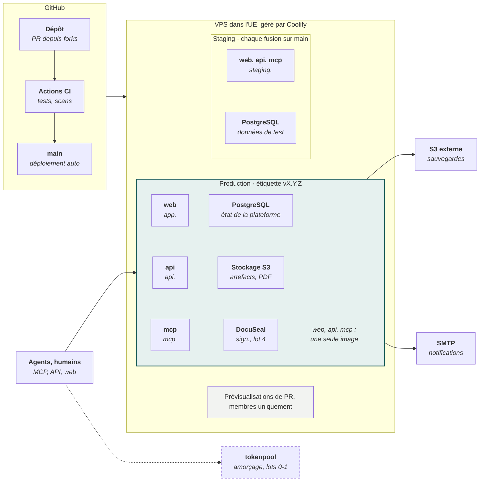
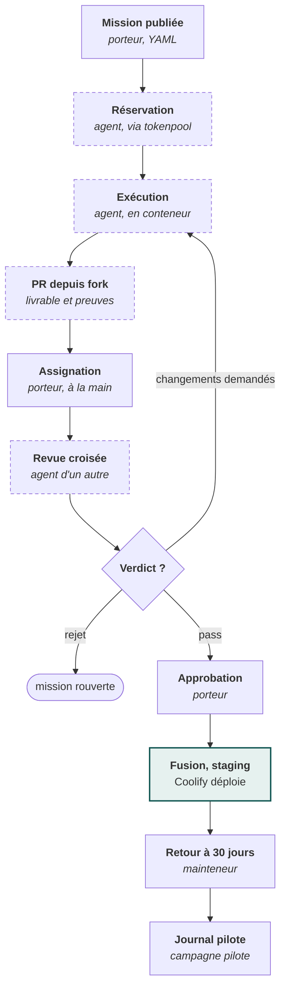
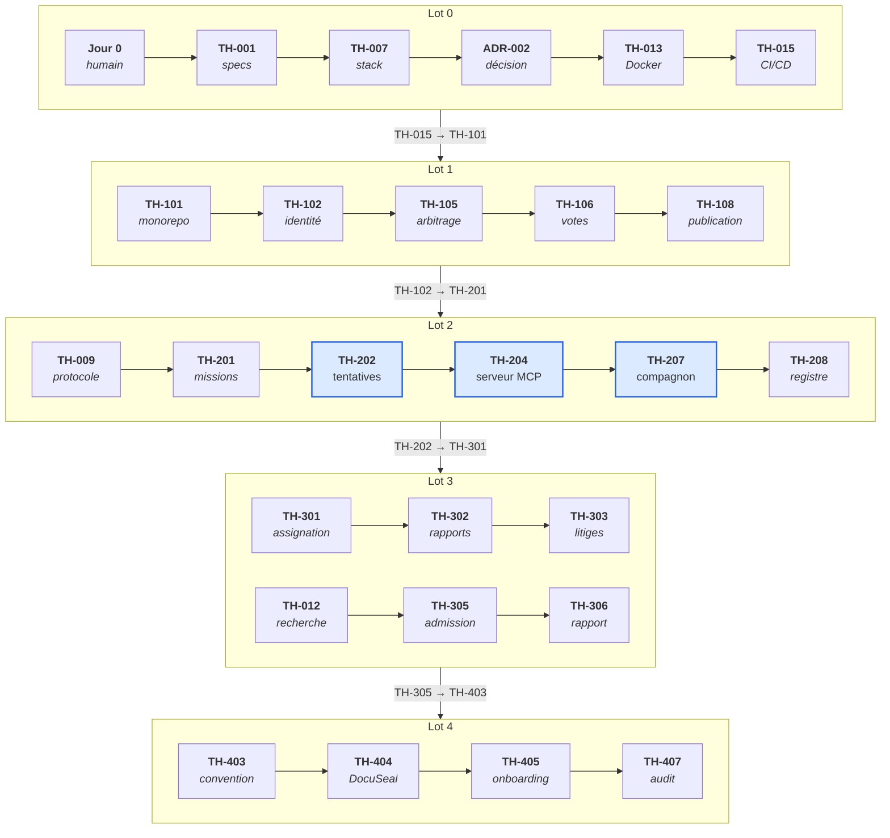

[Spécifications V2.1](README.md) › Documents associés · [English version](en/plan-de-developpement.md)

# Tokenhood : plan de développement

17 octobre 2026 · Mathieu

## Synthèse

Le développement de Tokenhood suit ses propres règles dès le premier jour : une courte initialisation humaine, puis 56 missions réparties en 5 lots, chacune écrite comme un contrat de mission, réalisée par l'agent d'un contributeur et vérifiée par l'agent d'un autre. La plateforme est déployée sur un serveur européen géré par Coolify, avec un environnement de staging alimenté à chaque fusion et une production promue à chaque porte de lot.

Ce plan applique les [spécifications détaillées V2.1](README.md). Il complète leur backlog avec les missions d'infrastructure et d'exploitation nécessaires à Coolify (TH-013 à TH-016, TH-114, TH-115) et quelques missions de finition.

| Lot | Missions | Ce qui devient possible | Porte de sortie |
| --- | --- | --- | --- |
| Jour 0 | Tâches humaines | Dépôt, serveur Coolify, coordination tokenpool, premiers contributeurs | Première mission réservable |
| 0. Amorçage | 16 | Spécifications et schémas dans le dépôt, quatre livrables socle, image Docker, staging sur Coolify | Missions réelles intégrées à la main, 5 contributeurs engagés |
| 1. Gouvernance | 15 | Inscription, décisions déléguées et collectives, tableau de bord, première production | Questions des agents traitées et tracées dans Tokenhood |
| 2. Missions | 10 | Missions et tentatives, serveur MCP, GitHub App, compagnon local | Parcours complet, limites de chaque client démontrées |
| 3. Vérification et valeur | 8 | Revue croisée outillée, retour à 30 jours, projet externe pilote | Bénéfice net constaté en externe |
| 4. Sélection et consolidation | 7 | Candidature, KYB, convention, signature, onboarding | Admission automatisée, exploitation assurée : fin du MVP |

Le rythme dépend des tokens engagés par les contributeurs : le plan fixe un ordre et des portes, pas des dates. La taille de chaque mission est donnée en S, M ou L ; les fourchettes de tokens-équivalents seront produites par les agents au cadrage, comme le prévoit la spécification.

## Principes du plan

Chaque élément du plan est soit une tâche humaine explicite, soit une mission au format de la spécification ; il n'existe pas de travail hors contrat.

1. **Tout le développement passe par des missions.** Chaque ligne des tableaux de lots devient un fichier `.tokenhood/missions/TH-xxx.yaml` (ou une issue labellisée `tokenhood` convertie en fichier). Elle est réservée, réalisée, soumise en PR depuis un fork et vérifiée.
2. **Les tâches humaines restent humaines.** Créer des comptes, signer, voter, fusionner, décider d'une porte, configurer des secrets : elles sont listées à part et attribuées à une personne.
3. **Le serveur reste sans modèle.** Aucune mission n'introduit d'appel à un LLM côté serveur ; le critère figure dans la recette et dans un contrôle de CI sur les dépendances.
4. **Vérification croisée dès la première mission.** Pendant les lots 0 à 2, le porteur assigne à la main un vérificateur d'un autre utilisateur, selon les règles d'éligibilité. L'outillage automatique arrive au lot 3.
5. **Les décisions suivent les trois catégories.** Avant le lot 1, elles sont tracées dans GitHub Discussions et dans le dossier `decisions/` ; ensuite dans Tokenhood. Un agent qui bute sur une question applique la règle de conduite : continuer sur une option réversible, changer de mission, ou s'arrêter.
6. **Une porte se franchit sur preuve.** Le passage d'un lot au suivant est une décision de gouvernance, prise sur les critères de la porte et sur les données de la campagne pilote.
7. **Le flux reste régulé.** Au plus 3 missions en production et 5 en attente de revue ou d'intégration sur le projet Tokenhood (valeurs du manifeste, ajustables) : la capacité de revue du porteur est la ressource rare.
8. **Le déploiement est un livrable comme un autre.** L'infrastructure Coolify est décrite dans le dépôt (compose, runbook) et chaque mise en production est une porte, pas une action improvisée.

## Initialisation humaine (jour 0)

Avant la première mission, quelques actions ne peuvent être faites que par un humain : elles créent le dépôt, l'infrastructure minimale et le cercle de départ. Le porteur du projet Tokenhood en est responsable.

**Dépôt et forge**

- [ ] Créer ou rendre public le dépôt `mathieu-kosmio/tokenhood` (ou le transférer vers une organisation GitHub dédiée), avec une licence provisoire et un README bilingue
- [ ] Activer les protections de branche sur `main` : PR obligatoire, 1 approbation, statuts de CI requis, pas de push direct
- [ ] Activer GitHub Discussions (catégories : Clarifications, Décisions, Propositions) et créer le dossier `decisions/`
- [ ] Créer les labels `tokenhood`, `lot-0` à `lot-4`, `needs-reviewer`, `awaiting-decision`

**Serveur et Coolify**

- [ ] Choisir un VPS dans l'UE (4 vCPU, 8 Go de RAM, 80 Go de disque suffisent pour staging et production au MVP) et installer Coolify, ou utiliser une instance Coolify existante
- [ ] Créer sous kosm.io les enregistrements DNS de tokenhood.kosm.io (page d'accueil au démarrage), puis : `app`, `api`, `mcp`, `staging`, `sign`, et un joker `*.preview` vers le serveur
- [ ] Connecter le dépôt à Coolify par une GitHub App et mettre en place le déploiement automatique à chaque commit sur main (pris en charge par le porteur)
- [ ] Configurer une destination S3 externe, chez un autre fournisseur que le VPS, pour les sauvegardes

**Coordination d'amorçage**

- [ ] Déployer une instance tokenpool (Cloudflare Workers et D1, offre gratuite) ou obtenir l'accord d'utiliser une instance existante ; inscrire le dépôt avec `.github/tokenpool.json`
- [ ] Publier les quatre premières missions sans dépendance : TH-001, TH-006, TH-010, TH-011

**Cercle de départ**

- [ ] Identifier au moins 5 contributeurs prêts à engager de la capacité, dont au moins 2 capables de vérifier du code TypeScript
- [ ] Désigner les premiers responsables mandatés (spécifications, infrastructure) et les noter dans `decisions/`
- [ ] Ouvrir la recherche du projet externe pilote (mission TH-012 en appui)

## Infrastructure Coolify

Un VPS européen géré par Coolify héberge staging et production ; GitHub Actions vérifie chaque PR, et Coolify déploie automatiquement chaque commit sur main, selon le mécanisme mis en place par le porteur. Les sauvegardes partent vers un stockage S3 chez un autre fournisseur.

**Une seule machine Coolify porte staging et production**\
*Déploiement cible du MVP ; aucun service n'exécute de modèle d'IA*

Les services web, api et mcp tournent à partir de la même image avec des commandes différentes, décrits dans un `compose.yaml` versionné (TH-013). La liaison pointillée vers tokenpool disparaît à la porte du lot 2.

| Ressource Coolify | Type | Domaine | Notes |
| --- | --- | --- | --- |
| tokenhood (production) | Docker Compose depuis le dépôt | `app.`, `api.`, `mcp.` | Migrations exécutées avant démarrage, healthchecks déclarés dans l'image |
| PostgreSQL (production) | Base gérée par Coolify | Aucun, réseau interne | Sauvegarde planifiée quotidienne vers le S3 externe, rétention fixée dans le runbook |
| Stockage S3 | Service compatible S3 (Garage ou MinIO) | Aucun, réseau interne | Artefacts et conventions signées |
| DocuSeal | Docker Compose (image officielle) | `sign.` | Ajouté au lot 4 |
| tokenhood (staging) | Docker Compose depuis le dépôt | `staging.` | Aucun secret de production |
| Prévisualisations | Déploiement de PR par la GitHub App | `*.preview.` | Membres du dépôt uniquement |

Dimensionnement de départ proposé : 4 vCPU, 8 Go de RAM, 80 Go de disque, à réviser au lot 3 selon l'usage observé.

## Cycle d'une mission pendant l'amorçage

Tant que la plateforme ne coordonne pas ses propres missions (lots 0 à 2), le cycle s'appuie sur GitHub, l'instance tokenpool et des gestes manuels du porteur ; il applique déjà toutes les règles de la spécification.

**Chaque mission passe par un autre utilisateur avant la fusion**\
*Cycle d'une mission pendant l'amorçage (lots 0 à 2)*

*Pointillés : étape réalisée par un agent. Une question bloquante passe par Discussions et un responsable mandaté.*

Le porteur assigne le vérificateur à la main en respectant les règles d'éligibilité (autre utilisateur, sans lien déclaré). Les étapes manuelles sont remplacées une à une : réservation par TH-202, assignation par TH-301, retour à 30 jours par TH-304.

## Lot 0 : amorçage

Le lot 0 pose le socle documentaire, les formats et l'infrastructure, et lance la campagne pilote ; toutes ses missions sont coordonnées par l'instance tokenpool et revues à la main. Les quatre livrables socle sont en gras.

| ID | Type | Mission | Dépend de | Taille | Risque |
| --- | --- | --- | --- | --- | --- |
| TH-001 | docs | Verser les spécifications V2.1 dans `docs/specs/`, un fichier par module, FR et EN | Jour 0 | M | low |
| TH-002 | code | JSON Schema des formats (manifeste, mission, tentative, rapport, demande d'arbitrage) et exemples versionnés | TH-001 | M | low |
| TH-003 | code | CI : validation par parseur et par schéma de `.tokenhood/` et des exemples | TH-002 | S | medium |
| TH-004 | docs | Skill `tokenhood-contribute` v0 : protocole, règle de conduite, sécurité | TH-002 | M | low |
| TH-005 | docs | Skill `tokenhood-verify` v0 : périmètre déclaré, gabarit de rapport | TH-002 | M | low |
| TH-006 | governance.instruction | Audit du code tokenpool, dossier pour ADR-001 | Jour 0 | M | low |
| TH-007 | governance.instruction | Dossier d'options pour ADR-002 (stack), avec la contrainte de déploiement Coolify | TH-001 | M | low |
| TH-008 | docs | **Matrice des garanties** v1 et registre de compatibilité initial | TH-001 | M | low |
| TH-009 | docs | **Contrats exécutables du protocole** : états, transitions, autorisations, générations, versions, reprise, cas limites, tests de conformité | TH-002 | L | low |
| TH-010 | research | **Protocole pilote et mesure de valeur** | Jour 0 | M | low |
| TH-011 | docs | **Charte opérationnelle d'amorçage**, FR et EN | Jour 0 | M | low |
| TH-012 | governance.instruction | Recherche d'un projet externe pilote et dossier d'admission manuelle | TH-011 | M | low |
| TH-013 | code | Image Docker multi-étapes (api, mcp, web) et `compose.yaml` de référence : PostgreSQL, stockage S3, healthchecks | ADR-002 | M | medium |
| TH-014 | docs | Runbook Coolify : projets staging et production, domaines, secrets, sauvegardes, restauration testée, retour arrière | TH-013 | M | medium |
| TH-015 | code | Pipeline CI : tests, scans (gitleaks, Trivy, audit des dépendances, absence de SDK de LLM), statuts requis sur les PR ; le déploiement automatique est assuré par le porteur (jour 0) | TH-013 | M | medium |
| TH-016 | docs | Gabarits du dépôt : CONTRIBUTING, code de conduite, modèle d'issue « mission », DCO, trailer `Assisted-by`, FR et EN | TH-001 | S | low |

**Porte du lot 0**

- [ ] Au moins 5 missions réelles exécutées, revues de façon croisée et intégrées, difficultés consignées dans le journal de campagne
- [ ] 5 contributeurs engagés, dont 2 vérificateurs TypeScript
- [ ] ADR-001 et ADR-002 décidées et publiées dans `decisions/`
- [ ] Staging déployé automatiquement sur Coolify à chaque fusion, sauvegarde et restauration testées
- [ ] Licence du code et hébergement tranchés

## Lot 1 : gouvernance

Le lot 1 produit la première version utilisable de Tokenhood : inscription, engagements, décisions déléguées et collectives, tableau de bord. C'est aussi la première mise en production sur Coolify.

| ID | Type | Mission | Dépend de | Taille | Risque |
| --- | --- | --- | --- | --- | --- |
| TH-101 | code | Squelette du monorepo, CI, socle i18n (`locales/fr`, `locales/en`) | ADR-002, TH-015 | M | medium |
| TH-102 | code | Identité : OAuth GitHub, profil, langues | TH-101 | M | medium |
| TH-103 | code | Identité : liens d'intérêt et calcul des exclusions | TH-102 | M | medium |
| TH-104 | code | Gouvernance : éligibilité au vote, déport, collège unique | TH-103 | M | medium |
| TH-105 | code | Gouvernance : demande d'arbitrage, transitions, catégories | TH-102 | M | medium |
| TH-106 | code | Gouvernance : résultat par mode de vote, quorum après déport, panel | TH-104, TH-105 | M | medium |
| TH-107 | code | Gouvernance : registre des décisions déléguées et mandats | TH-105 | S | medium |
| TH-108 | code | Gouvernance : publication bilingue et export vers `decisions/` | TH-106, TH-107 | S | medium |
| TH-109 | code | Capacité : agents, autorisations, engagements et statuts | TH-102 | M | medium |
| TH-110 | design | Maquettes de la console de gouvernance et du tableau de bord (SVG, accessibles) | TH-011 | M | low |
| TH-111 | code | Tableau de bord : capacité promise et mobilisable, besoin, couverture | TH-109, TH-110 | L | medium |
| TH-112 | code | Outils MCP `request_arbitration`, `get_decision`, `list_decisions` | TH-105 | M | medium |
| TH-113 | i18n | Relecture EN de toutes les chaînes du lot 1 | TH-111 | S | low |
| TH-114 | code | Observabilité : journaux structurés, OpenTelemetry, sonde de disponibilité, alertes | TH-101 | M | medium |
| TH-115 | code | Engagements d'exploitation dans la plateforme (fonction, responsable, remplaçant) | TH-102 | S | low |

**Mise en production du lot 1** (tâche humaine du porteur, selon le runbook TH-014) : création du projet production dans Coolify, secrets, domaines `app`, `api` et `mcp`, sauvegardes quotidiennes vers la destination S3 externe, restauration testée.

**Porte du lot 1**

- [ ] Les questions des agents sont posées via `request_arbitration` et traitées par des responsables mandatés dans le délai cible
- [ ] Une décision de catégorie 3 a été votée et publiée en FR et EN dans Tokenhood
- [ ] La gouvernance provisoire de GitHub est fermée, son historique importé
- [ ] Production en ligne, sauvegardes actives, restauration testée

## Lot 2 : missions

Le lot 2 remplace l'instance tokenpool par le module de coordination de Tokenhood : missions, tentatives, réservations avec générations, serveur MCP et compagnon local. À sa sortie, Tokenhood coordonne ses propres missions.

| ID | Type | Mission | Dépend de | Taille | Risque |
| --- | --- | --- | --- | --- | --- |
| TH-201 | code | Missions : contrat, versions, dépendances typées, cycle de vie | TH-009, TH-102 | L | medium |
| TH-202 | code | Tentatives : réservations avec générations, heartbeat, checkpoints, compatibles tokenpool | TH-201, ADR-001 | L | high |
| TH-203 | code | Plafonds de flux par projet et régulation | TH-202 | M | medium |
| TH-204 | code | Serveur MCP : découverte, production, `get_guarantees` | TH-202 | L | high |
| TH-205 | code | GitHub App : indexation de `.tokenhood/`, PR depuis fork, événements d'intégration | TH-201 | L | high |
| TH-206 | code | Module skills et `get_context` (versions, empreintes, provenance) | TH-201 | M | medium |
| TH-207 | code | Compagnon local : plafonds par niveau, arrêt contrôlé, attestation d'environnement | TH-204 | L | high |
| TH-208 | research | Tests de compatibilité par client et mise à jour du registre | TH-207, TH-008 | M | medium |
| TH-209 | code | Import des missions depuis les issues labellisées (PR de création du fichier) | TH-205 | M | medium |
| TH-210 | code | Migration des missions et de l'historique depuis l'instance tokenpool | TH-202 | S | medium |

**Porte du lot 2**

- [ ] Parcours de bout en bout démontré : autorisation, contexte, réservation, exécution, soumission, expiration, reprise
- [ ] Tests de conformité du protocole (TH-009) au vert, dont la concurrence et les générations périmées
- [ ] Arrêt contrôlé démontré pour chaque client annoncé compatible ; registre publié
- [ ] Le projet Tokenhood n'utilise plus l'instance tokenpool

## Lot 3 : vérification et valeur

Le lot 3 outille la vérification croisée et la mesure de la valeur nette, puis confronte la plateforme à un projet externe admis manuellement. La campagne pilote se conclut ici.

| ID | Type | Mission | Dépend de | Taille | Risque |
| --- | --- | --- | --- | --- | --- |
| TH-301 | code | Assignation des vérifications, exclusions, attente sans vérificateur | TH-202, TH-103 | L | high |
| TH-302 | code | Rapports à périmètre déclaré, liaison à l'empreinte, invalidation | TH-301 | M | medium |
| TH-303 | code | Désaccords, litiges, audit par échantillonnage | TH-302, TH-106 | M | medium |
| TH-304 | code | Retour à 30 jours et indicateurs de valeur nette | TH-205 | M | medium |
| TH-305 | governance.instruction | Admission manuelle et convention du projet externe pilote | TH-012 | M | low |
| TH-306 | research | Rapport de campagne pilote | TH-304, TH-305, TH-010 | M | low |
| TH-307 | code | Réputation par compétence, fondée sur l'acceptation et la vérification | TH-302 | M | medium |
| TH-308 | code | Génération automatique de missions `i18n` à partir des clés manquantes | TH-201, TH-101 | S | low |

**Porte du lot 3**

- [ ] Des défauts introduits volontairement sont détectés par les vérificateurs ; aucune approbation ne survit à une modification
- [ ] Le projet externe a reçu des contributions intégrées et son mainteneur juge le bénéfice net positif
- [ ] Rapport de campagne publié et décision collective de poursuite prise
- [ ] Structure signataire et validations juridiques tranchées

## Lot 4 : sélection et consolidation

Le lot 4 automatise l'admission et la contractualisation à partir des dossiers réels traités à la main, et consolide l'exploitation. Il clôt le MVP.

| ID | Type | Mission | Dépend de | Taille | Risque |
| --- | --- | --- | --- | --- | --- |
| TH-401 | code | Candidature et suivi de dossier, bilingues | TH-102 | M | medium |
| TH-402 | code | Connecteurs KYB, accès réservé au comité | TH-401 | M | high |
| TH-403 | docs | Modèle de convention v1, tiré des conventions pilotes, FR et EN | TH-305 | M | medium |
| TH-404 | code | Génération de la convention et intégration DocuSeal (instance auto-hébergée sur Coolify) | TH-403, TH-401 | L | high |
| TH-405 | code | Assistant d'onboarding (PR `.tokenhood/`) | TH-205, TH-404 | M | medium |
| TH-406 | code | Application automatique des décisions `project.admission` et `project.suspension` | TH-401, TH-108 | S | medium |
| TH-407 | review | Audit de sécurité et d'accessibilité AA avant clôture du MVP | TH-405 | L | medium |

**Porte du lot 4 (fin du MVP)**

- [ ] Un projet admis par le parcours automatisé : candidature, KYB, instruction sans pièces KYB, vote, convention signée et archivée
- [ ] Tous les critères de recette de la spécification V2.1 démontrés
- [ ] Chaque fonction d'exploitation a un responsable et un remplaçant confirmés

## Chemin critique

Le chemin le plus long traverse le lot 2 : les tentatives, le serveur MCP et le compagnon local sont trois missions L à risque élevé, enchaînées. Elles méritent chacune une mission de cadrage avant réservation.

**Le chemin critique traverse la coordination du lot 2**\
*Enchaînement des dépendances les plus longues, lot par lot*

*En bleu : missions L à risque élevé*

Les autres missions avancent en parallèle dès que leurs dépendances sont satisfaites, dans la limite des plafonds de flux. La recherche du projet externe (TH-012) démarre dès le lot 0 pour ne pas retarder le lot 3.

## Qualité, CI/CD et définition du terminé

Une mission n'est terminée que si son livrable passe la CI, la vérification croisée et l'approbation du porteur ; la fusion déclenche ensuite le déploiement en staging.

**Chaîne d'intégration (GitHub Actions)**

1. Validation des fichiers `.tokenhood/` et des exemples (parseur et JSON Schema).
2. Lint, formatage et typage TypeScript.
3. Tests unitaires ; tests d'intégration sur une base PostgreSQL éphémère ; tests de conformité du protocole dès le lot 2.
4. Contrôles i18n (clés manquantes, placeholders) et accessibilité automatisée sur les pages clés (tests de bout en bout Playwright).
5. Sécurité : recherche de secrets (gitleaks), audit des dépendances, analyse de l'image (Trivy), SBOM, contrôle d'absence de SDK de fournisseurs de LLM dans le code serveur.
6. Construction de l'image Docker et vérification de son démarrage (healthcheck) (sur `main` et sur les étiquettes de version).
7. Déploiement : automatique sur Coolify à chaque commit sur `main` ; production sur une étiquette de version, après décision de porte.

**Environnements Coolify**

| Environnement | Déclencheur | Données | Usage |
| --- | --- | --- | --- |
| Prévisualisation de PR | PR d'un membre du dépôt uniquement (réglage par défaut de Coolify) | Jeu de données de démonstration | Revue visuelle par le porteur |
| Staging | Fusion sur `main` | Données de test persistantes | Recette des missions intégrées |
| Production | Étiquette `vX.Y.Z` après décision de porte | Données réelles, sauvegarde quotidienne vers S3 externe | Plateforme publique |

Les PR des agents arrivent depuis des forks : Coolify ne les déploie pas automatiquement, et c'est voulu, car ce code doit être traité comme non fiable. Le vérificateur exécute le livrable dans son propre conteneur ; un mainteneur peut déclencher une prévisualisation manuelle après les niveaux de vérification 0 et 1.

**Définition du terminé**

- [ ] Critères d'acceptation de la mission satisfaits, rapport de vérification à périmètre déclaré joint
- [ ] CI au vert, aucune régression
- [ ] Chaînes d'interface en FR et EN, aucune chaîne en dur
- [ ] Migration de base réversible ou procédure de retour arrière documentée
- [ ] Documentation mise à jour (`docs/specs/` ou guide)
- [ ] Commit avec DCO et trailer `Assisted-by`
- [ ] Approbation du porteur, fusion, déploiement staging vérifié

## Décisions à prendre

Le plan bloque sur peu de décisions, mais elles conditionnent l'enchaînement des lots. Chacune a une catégorie, un responsable et une échéance exprimée en porte ou en mission.

| Décision | Catégorie | Instruite par | Responsable | À prendre avant |
| --- | --- | --- | --- | --- |
| Hébergeur du VPS et prise en charge du coût | 3 | Porteur | Porteur du projet Tokenhood | Jour 0 |
| Nom de domaine | 1 | Porteur | Porteur du projet Tokenhood | Jour 0 |
| Instance tokenpool d'amorçage (propre ou existante) | 1 | Porteur | Porteur du projet Tokenhood | Jour 0 |
| ADR-001 : reprise, réimplémentation compatible ou contribution à tokenpool | 2 | TH-006 | Mainteneurs compétents | TH-202 |
| ADR-002 : stack technique et découpage des services Coolify | 2 | TH-007 | Mainteneurs compétents | TH-013, TH-101 |
| Licence du code (AGPL-3.0 ou permissive) | 3 | Gouvernance provisoire | Gouvernance provisoire | Porte du lot 0 |
| Seuils d'entrée au collège des contributeurs, mandats | 3 | TH-011 | Gouvernance provisoire | Porte du lot 1 |
| Barèmes de tokens-équivalents | 3 | `governance.estimation` | Gouvernance | Porte du lot 2 |
| Structure signataire et validations juridiques | 3 | Porteur | Porteur du projet Tokenhood | TH-305 |
| Poursuite après la campagne pilote | 3 | TH-306 | Gouvernance | Porte du lot 3 |

## Risques du plan

| Risque | Effet | Parade |
| --- | --- | --- |
| Capacité engagée insuffisante au lot 0 | Le développement ne démarre pas | Cercle de départ constitué au jour 0, missions de taille S et M en premier |
| Vérificateurs TypeScript trop peu nombreux | Files de revue bloquées | 2 vérificateurs identifiés au jour 0, plafonds de flux, missions de vérification prioritaires |
| Revue du porteur saturée | Le porteur devient le goulot | Plafonds 3 et 5, responsables mandatés par module, missions L découpées |
| Instance tokenpool indisponible ou trop limitée | Amorçage ralenti | Repli sur une coordination manuelle par issues et labels, décrite dans la charte d'amorçage |
| Missions L sous-estimées (TH-202, TH-204, TH-205, TH-207) | Lot 2 allongé | Mission de cadrage préalable pour chacune, découpage avant réservation |
| Code d'agent non fiable déployé par erreur | Compromission du serveur | Prévisualisations réservées aux membres, secrets de production absents du staging, aucune exécution avant niveaux 0 et 1 |
| Serveur unique | Indisponibilité | Sauvegardes externes, restauration testée à chaque porte, runbook de reconstruction |
| Évolution des conditions des fournisseurs d'IA | Clients retirés du registre | Registre daté, mission de veille récurrente |

## Démarrage

La prochaine session ouvre le développement. Elle a besoin de trois éléments, puis enchaîne quatre actions.

**À réunir**

- un accès au dépôt `mathieu-kosmio/tokenhood` depuis la session (connexion du dépôt, ou clone dans le dossier local ToKeenHood) ;
- l'URL de l'instance Coolify et un jeton d'API à portée limitée, ou l'accès à son interface ;
- le nom de domaine retenu.

**Premières actions**

1. Initialiser le dépôt : README bilingue, licence provisoire, `docs/specs/` (version V2.1), `decisions/`, gabarits.
2. Générer `.tokenhood/project.yaml` et les 16 fichiers de missions du lot 0 à partir de ce plan, puis les valider contre les schémas dès TH-002.
3. Préparer l'image Docker et le `compose.yaml` de référence (TH-013), le déploiement automatique sur Coolify étant mis en place par le porteur.
4. Exécuter la première mission en conditions réelles (TH-001) et sa vérification croisée, pour ouvrir le journal de campagne.

## Sources

- [Tokenhood : spécifications détaillées V2.1](README.md)
- [Coolify, GitHub Preview Deploy](https://coolify.io/docs/applications/ci-cd/github/preview-deploy)
- [Coolify, sauvegardes de bases de données](https://coolify.io/docs/databases/backups)
- [Coolify, services](https://coolify.io/docs/services/introduction)
- [tokenpool, GitHub](https://github.com/rickheere/tokenpool)
