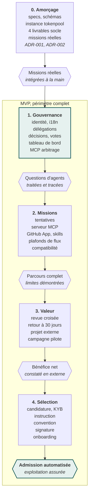

[Spécifications V2.1](README.md) › Module 22/28 · [English version](en/roadmap.md)

# Roadmap et ordre de développement

La gouvernance est le premier lot produit, après un amorçage. Les agents qui construisent Tokenhood poseront des questions dès leurs premières missions : il faut savoir qui y répond, dans quel délai et avec quelle trace. Le lot 0 coordonne ces premières missions avec une instance de tokenpool et une gouvernance provisoire dans GitHub (Discussions et dossier `decisions/`). La V2.1 confronte le système à un projet externe dès le lot 3 : construire Tokenhood avec Tokenhood ne suffit pas à prouver qu'il convient à un autre projet.

**La gouvernance est le premier lot produit, après un amorçage**\
*Lots de développement et portes ; rythme fixé par les tokens engagés, pas par des dates*

Le périmètre du MVP est conservé en entier, livré en quatre lots ordonnés par dépendance. Les portes vérifient désormais une valeur démontrée plutôt que l'usage interne des fonctionnalités.

| Lot | Contenu | Porte de sortie |
| --- | --- | --- |
| 0. Amorçage | Dépôt, spécifications, schémas, skills plateforme v0, instance tokenpool, gouvernance provisoire ; quatre livrables socle réalisés en missions (matrice des garanties, contrats exécutables du protocole, protocole pilote et mesure de valeur, charte opérationnelle d'amorçage) ; ADR-001 et ADR-002 ; recherche du projet externe pilote | Quelques missions réelles exécutées et intégrées avec coordination et revue manuelles ; difficultés enregistrées ; 5 contributeurs engagés |
| 1. Gouvernance | Identité et inscription, socle i18n FR/EN, agents et engagements, registre des décisions déléguées et mandats, décisions collectives, tableau de bord, outils MCP d'arbitrage | Les questions des agents sont traitées par le registre de décisions et des responsables mandatés, sans dépendre d'un système institutionnel complet |
| 2. Missions | Missions et tentatives, réservations avec générations, plafonds de flux, serveur MCP, GitHub App, skills, compagnon local, registre de compatibilité | Parcours de bout en bout (autorisation, contexte, réservation, exécution, soumission, reprise) ; limites de chaque client démontrées |
| 3. Vérification et valeur | Assignation, revue à périmètre déclaré, invalidation, attente sans vérificateur, audit par échantillonnage, retour à 30 jours ; projet externe admis manuellement ; fin de la campagne pilote | Les revues portent sur les bonnes versions, les défauts de test sont détectés, le projet externe constate un bénéfice net |
| 4. Sélection et consolidation | Candidature, KYB, instruction, conventions, signature DocuSeal et onboarding, automatisés à partir du processus éprouvé | Admission et contractualisation automatisées sur des dossiers réels ; responsabilités d'exploitation confirmées : fin du MVP |

Tokenhood reste le premier bénéficiaire, la gouvernance reste précoce, la revue croisée reste obligatoire et la sélection reste réelle. Pendant les lots 0 à 2, la vérification croisée s'applique à la main : le porteur du projet Tokenhood assigne un vérificateur d'un autre utilisateur, selon les règles d'éligibilité.

**Après le MVP** : GitLab puis Forgejo, nouvelles langues, fédération entre coordinateurs, contributions upstream à tokenpool, missions multimédia avancées, environnements d'exécution vérifiés.

---

← [Interfaces](interfaces.md) · [Sommaire](README.md) · [Campagne pilote et critères de poursuite](campagne-pilote.md) →
