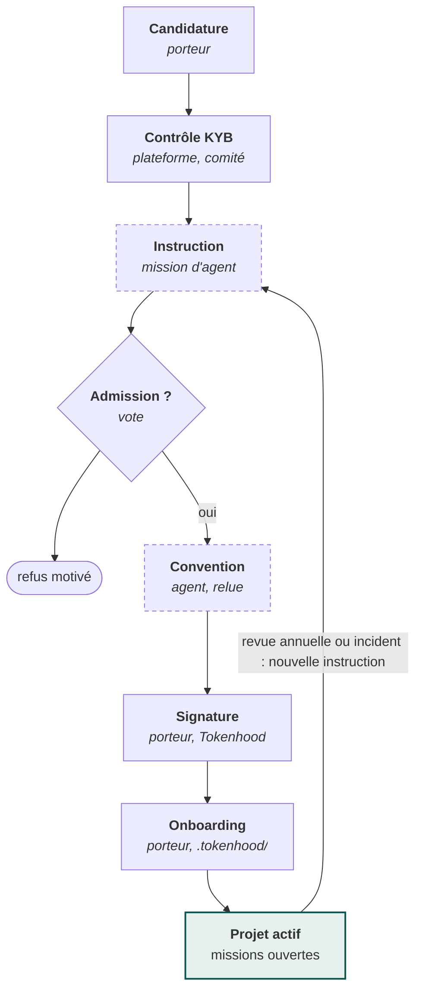

[Spécifications V2.1](README.md) › Module 8/28 · [English version](en/selection-et-contractualisation.md)

# Sélection des projets et contractualisation

Les projets sont sélectionnés minutieusement : un projet n'ouvre des missions qu'après contrôle KYB, vote de la gouvernance et signature d'une convention dans la plateforme. Ce processus est une fonctionnalité du MVP.

**Un projet devient actif après KYB, vote et signature**\
*Processus de sélection et de contractualisation*

*Pointillés : étape réalisée par une mission d'agent puis validée par un humain*

Les étapes cognitives (instruction, rédaction de la convention) sont des missions confiées aux agents des contributeurs ; les décisions et signatures restent humaines.

**Pendant le pilote** (lots 0 à 3), l'admission et la convention sont traitées manuellement selon les mêmes exigences, documentées, puis enregistrées dans Tokenhood. L'automatisation complète du lot 4 reprend le processus éprouvé sur ces dossiers réels. Les contrôles d'admission vérifient un porteur, son contrôle du dépôt et sa capacité à s'engager ; la sûreté technique du contenu du dépôt reste couverte par les protections d'exécution, qui s'appliquent en complément.

**Candidature.** Formulaire bilingue : dépôt(s), licence, description, gouvernance du projet, structure porteuse, mainteneur référent, besoins prévus (types de missions, volume estimé), lien avec les communs numériques ou la transition.

**Contrôle KYB** (Know Your Business), selon la forme du porteur :

| Porteur | Vérifications | Source |
| --- | --- | --- |
| Personne morale française | SIREN actif, dirigeants, cohérence avec le signataire | [API Recherche d'entreprises](https://github.com/annuaire-entreprises-data-gouv-fr/search-api) |
| Personne morale hors France | Immatriculation, représentant légal | Registre national ou LEI, pièces justificatives |
| Fondation ou hôte fiscal | Statut, mandat du projet | Pièces justificatives, page officielle |
| Collectif sans structure | Identité vérifiée de 2 mainteneurs au moins | Vérification d'identité renforcée |
| Tous | Contrôle du dépôt (droits d'admin, fichier de preuve), licence reconnue OSI, activité récente | API de la forge |

**Instruction.** Une mission d'instruction (type `governance.instruction`) produit un dossier normalisé : synthèse, grille de critères notée, risques, recommandation. L'agent instructeur reçoit uniquement la candidature et des données publiques (dépôt, licence, activité, site du projet) ; les pièces et résultats du KYB ne sont jamais transmis à un agent et restent réservés au comité de sélection, qui les contrôle lui-même. L'agent instructeur ne doit avoir aucun lien déclaré avec le projet. Critères de la grille (pondérations fixées par la gouvernance) : licence et ouverture, gouvernance du projet, capacité de revue des mainteneurs, utilité pour les communs, maturité du découpage en missions, préparation à recevoir des contributions d'agents, sécurité, alignement avec la charte.

**Décision.** Une demande d'arbitrage de type `project.admission` est ouverte dans le module de gouvernance. Vote à la majorité qualifiée, avec déport des membres liés.

**Convention.** Générée à partir d'un modèle versionné dans le dépôt `tokenhood` (Markdown à variables), complétée par une mission d'agent, relue par le comité. Contenu minimal :

- objet, durée (12 mois renouvelables), référent du projet ;
- engagements du projet : délai maximal de revue, qualité des missions, respect de la vérification croisée, licence, code de conduite, transparence des résultats ;
- engagements de Tokenhood : orchestration, sécurité, neutralité d'allocation, publication de l'impact ;
- propriété intellectuelle : contributions sous la licence du projet, DCO ;
- données personnelles, suspension, résiliation, litiges.

**Signature.** Signature électronique via une instance auto-hébergée de [DocuSeal](https://dev.co/devops/open-source/docuseal) (AGPL-3.0, API et webhooks), utilisée sans modification. Le PDF signé et la piste d'audit sont archivés ; l'empreinte du document est enregistrée dans le journal d'audit de Tokenhood.

**Onboarding.** Le porteur installe `.tokenhood/` dans son dépôt (assistant générant une PR), la plateforme vérifie le manifeste et active le projet.

**Statuts d'un projet** : `candidate` → `kyb_pending` → `under_review` → `approved` / `rejected` → `contract_pending` → `active` → `suspended` / `ended`.

---

← [Inscription et identité](inscription-et-identite.md) · [Sommaire](README.md) · [Missions](missions.md) →
